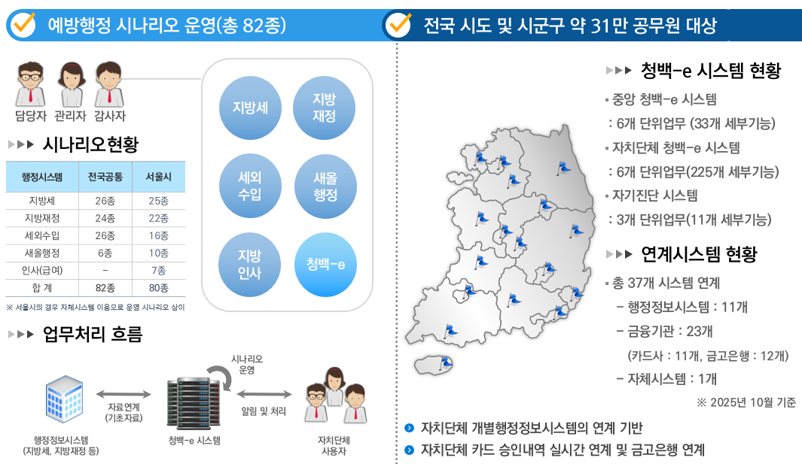
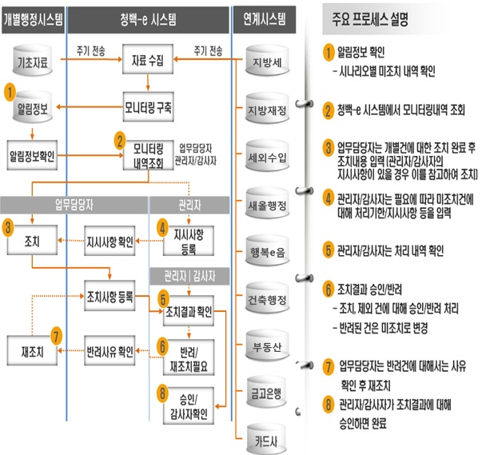
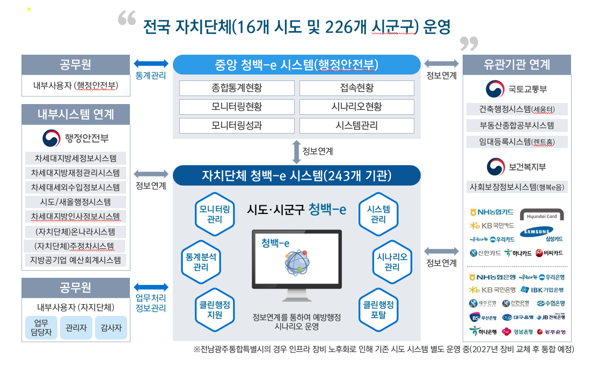

# 2027년 자치단체 상시모니터링(청백-e) 시스템 유지관리 제안요청서(RFP)

> 발주기관: 한국지역정보개발원 · 2026. 11.
> 원본: `[붙임] 제안요청서_구매업무협의 반영.hwpx` (Ⅰ. 사업개요 ~ Ⅵ. 제안 안내사항)

---

# Ⅰ. 사업개요

## 1. 추진배경 및 필요성

**가.** 자치단체 자율적 내부통제 제도의 효율적 운영을 위해 구축된 정보시스템의 지속적 유지관리 필요

- 1) 제도 변경, 사용자 요구사항 등에 따른 청백-e 시스템의 응용SW 기능 변경‧추가‧보완 등 지속적 개선
- 2) 시스템 전산장비(상용SW·HW)의 안정적 운영을 위한 유지관리 필요

**나.** 자치단체 공무원의 비리 및 행정착오의 상시적 예방을 위해 예방행정 프로그램의 개선, 기능 고도화 및 발전방안 마련

- 1) 청백-e 시스템의 이용 활성화를 위해 사용자 교육, 사용법 문의응대 등 사용자 지원활동 수행
- 2) 예방행정 시나리오, 시스템 기능 개선 및 청백-e 시스템 개선을 위한 장‧단기 발전방안 마련
- 3) 개별행정시스템 및 유관 정보시스템과의 안정적인 연계서비스 제공을 통한 효과적인 시나리오 운영

### 다. 노후장비 교체를 통한 시스템 보안 강화 및 성능 향상

- 1) 노후화된 인프라 장비(2012~14년 도입) 교체 및 상용SW 이전 등 운영환경 변화에 따른 시스템 수정 필요
- 2) 자료 이관 등 원활한 시스템 운영을 위한 최적화 활동 수행

## 2. 주요 사업내용

### 가. 사업관리

- 1) 정기·상시 업무보고 및 이행사항 관리 등 사업관리
- 2) 사업참여자 보안교육 및 주기적인 보안점검 실시
- 3) 시스템 운영 관련 유관기관 간 업무협의 등

### 나. 상시 모니터링(청백-e) 시스템 응용SW 및 상용SW·HW 유지관리

- 1) 국가정보자원관리원 및 16개 시도에 설치된 상용 SW·HW 유지관리
- 2) 법·제도 변경, 환경변화 및 자치단체 요청에 따른 응용SW 기능개선

### 다. 시스템 활성화를 위한 사용자 운영지원

- 1) 예방행정 프로그램의 신규 발굴·개선 및 운영을 위한 지원활동
- 2) 자치단체 현장방문, 실무·연계협의회 등 의사소통 체계 운영
- 3) 사용자 온·오프라인 교육 실시 등 사용자 지원활동
- 4) 기타 시스템 활용 관련 업무지원 및 개선방안 마련 등 정책활동
- 5) 감사업무의 편의성 향상을 위한 자동화 기능 개발

### 라. 자치단체 예방행정 시나리오 운영·관리 기능 강화

- 1) 시·군·구 연계 모니터링을 통한 신속·정확한 시나리오 정상화 추진
- 2) 신규 시나리오 발굴 시 주요 행정시스템(인사, 재정, 세외수입, 지방세, 새올행정) 외에도 다른 행정정보시스템 연계를 추진하여 효과적인 예방행정 시나리오 발굴(감사지원 시나리오 포함)

### 마. 행정구역 개편에 따른 시스템 연속성 확보를 위한 지원 강화

- 1) 행정구역 개편에 대비한 사전 준비, 시스템 전환 지원을 통해 서비스 중단 및 업무 영향도를 최소화하고 연속적인 시스템 운영 확보

### 바. 노후장비 교체에 따른 시스템 수정 및 데이터 이관‧검증 지원

- 1) 신규 장비 운영환경에 맞춘 시스템 수정 및 운영 검증 작업 지원
- 2) 자료 이관 등 원활한 시스템 운영을 위한 최적화 활동 수행

## 3. 기대효과

- 지방세 과세, 세외수입 부과 누락을 방지하여 지방세원 확보에 기여
- 법인카드 부당 사용금액 환수 등 지방재정 지출의 투명성 제고
- 지방 행정과 관련된 다양한 행정정보시스템과 정보를 공유하고, 모니터링을 강화하여 청렴하고 투명한 지방행정 구현

---

# Ⅱ. 현황

## 1. 업무 현황

### 가. 개념도

### 나. 처리절차도

## 2. 정보화 현황

### 가. 중앙 청백-e

| 구분 | 서비스 내용 |
|---|---|
| 종합통계현황 | 종합현황 |
| 모니터링현황 | 모니터링결과, 업무별조치현황, 자치단체별조치현황, 시나리오별조치현황, 업무별 월별 처리현황, 자치단체별 월별 처리현황, 시나리오별 월별 처리현황, 자치단체별 자기진단작성현황, 업무외 시간별 사용현황, 근무지 이외지역 사용현황, 동일일자 동일거래처 사용현황, 사용금지 업종별 사용현황 |
| 모니터링성과 | 지표평가항목등록, 평가지표서배포, 평가현황, 모니터링성과, 시나리오 유형별 운영성과, 업무별 운영성과, 시도 유형별 운영성과 |
| 접속현황 | 사용자접속현황(일계), 사용자접속현황(누계), 업무별 사용자현황, 자치단체 업무별 사용자현황 |
| 시나리오현황 | 시나리오관리현황, 시나리오승인, 시나리오검증, 연계유형별, 주기별, 발굴현황 |
| 시스템관리 | 비밀번호변경, 사용자관리, 권한관리 |

### 나. 자치단체 청백-e

| 구분 | 서비스 내용 |
|---|---|
| 모니터링관리 | 예방프로그램, 조치결과확인, 모니터링알림정보, 지방재정부서매핑, 국고보조금, 과오납환급계좌매핑, 사업자등록번호관리, 모니터링재배부, 모니터링결과, 모니터링담당자, 예방프로그램부서배정, 모니터링처리사유목록 |
| 통계분석관리 | 모니터링총괄현황, 예방프로그램별현황, 부서별경보발생현황, 모니터링성과, 부서별모니터링일자별현황, 일일보고, 경보발생추이현황, 단수시나리오통계현황 |
| 클린행정지원 | 모니터링데이터제공, 통계데이터제공,지출결의및청구정보,금융거래정보조회, 실적평가, 실적확인, 공직자자기관리 실적순위, 공직자자기관리 평가항목별평가, 공직자자기관리 실적추이 |
| 클린행정포탈 | 공지사항, 자료실, FAQ |
| 시나리오관리 | 내 시나리오관리, 시나리오현황, 시나리오발굴, 시나리오승인, 시나리오검증, 시나리오적용, 시나리오사후관리, 시나리오통계현황, 시나리오기준정보, 카드별제외시나리오설정 |
| 자기진단 | 진단표 선택, 진단표 작성, 진단수행현황, 시스템관리 |
| 시스템관리 | 권한그룹관리, 프로그램관리, 공통코드관리, 메뉴관리, 권한관리, 사용자관리, 팝업관리, 로그관리, 모니터링업무배정, 모니터링규칙관리, 조직개편, 권한그룹 사용자관리, 사용자세부권한관리, 시나리오권한관리, 개인정보관리지원, 로고 이미지관리 |

### 다. 운영지원홈페이지

| 구분 | 서비스 내용 |
|---|---|
| 알림터 | 시스템소개, 공지사항, 운영지원단소개, 담당자연락처 |
| 서비스요청 | 서비스접수, FAQ, 업무담당자, 전화접수, 전화요청 |
| 자료실 | 청백-e 업무 매뉴얼, 청백-e 동영상 매뉴얼, 청백-e 교육교재(PPT), 개별모니터링 교육교재, 사업단자료실(운영용), 합동집무자료제출 |
| 커뮤니티 | 감사결과 사례, 감사사례등록요청, 적극행정면책사례, 사전컨설팅사례, 시책우수사례, 자료실, 실무협의회 이동 |
| 실무협의회 | 실무협의회 목록, 실무협의회 관리, (팝업)실무협의회 토론장, (팝업)실무협의회 공지사항 |
| 교육지원 및 현장지원 | 중앙교육신청, 권역·방문교육신청, 현장방문신청, 현장교육, 교육결과, 신청확인/취소 |
| 설문조사 | 설문조사, 만족도조사 |
| 서비스처리현황 | 서비스처리현황 |
| 감사사례 통합 검색 | 감사사례 통합 검색 |
| 관리메뉴 | 사용자관리, 운영지원현황, 월별처리현황, 사용자현황, 작업공지, 보고서, 회의록 |

### 라. 배포시스템

| 구분 | 서비스 내용 |
|---|---|
| 공통 | 로그인, 메인 |
| 배포관리 | 기능개선관리, 배포파일관리, 배포처리관리, 배포처리결과, 긴급배포 처리관리, 긴급배포처리결과, 배포이력관리, DB배포관리, DB배포결과 |
| 모니터링관리 | 모니터링관리 |
| 기준정보관리 | 사용자관리, 산출물관리, 자치단체관리 |

## 3. 예방행정 프로그램 운영현황

| 구분 | 전국 공통(특수지역 제외) | 특수지역(서울시) | 비고 |
|---|---|---|---|
| 계 | 88 | 86 |  |
| 지방세 | 26 | 25 |  |
| 지방재정 | 27 | 25 |  |
| 세외수입 | 26 | 16 |  |
| 새올행정 | 6 | 10 |  |
| 급여 | - | 7 |  |
| 지방인사 | - | 7 |  |
| 감사지원 | 3 | 3 |  |

| 구분 |  | 소계 | 지방세 | 지방재정 | 세외수입 | 새올행정 | 지방인사 |
|---|---|---|---|---|---|---|---|
| 2026 | 운영 | 85 | 26 | 27 | 26 | 6 | 0 |
|  | 구현 | 0 | 0 | 0 | 0 | 0 | 0 |
|  | 통합 | 3 | 0 | 3 | 0 | 0 | 0 |
|  | 폐기 | 0 | 0 | 0 | 0 | 0 | 0 |
| 2025 | 운영 | 82 | 26 | 24 | 26 | 6 | 0 |
|  | 구현 | 0 | 0 | 0 | 0 | 0 | 0 |
|  | 통합 | 0 | 0 | 0 | 7 | -7 | 0 |
|  | 폐기 | 3 | 3 | 0 | 0 | 0 | 0 |
| 2024 | 운영 | 85 | 29 | 24 | 19 | 13 | 0 |
|  | 구현 | 0 | 0 | 0 | 0 | 0 | 0 |
|  | 통합 | 0 | 0 | 0 | 0 | 0 | 0 |
|  | 폐기 | 0 | 0 | 0 | 0 | 0 | 0 |
| 2023 | 운영 | 85 | 29 | 24 | 19 | 13 | 0 |
|  | 구현 | 2 | 0 | 1 | 0 | 1 | 0 |
|  | 통합 | 0 | 0 | 0 | 0 | 0 | 0 |
|  | 폐기 | 18 | 0 | 7 | 1 | 0 | 10 |
| 2022 | 운영 | 101 | 29 | 30 | 20 | 12 | 10 |
|  | 구현 | 0 | 0 | 0 | 0 | 0 | 0 |
|  | 통합 | -1 | 0 | -1(2→1) | 0 | 0 | 0 |
|  | 폐기 | 0 | 0 | 0 | 0 | 0 | 0 |
| 2021 | 운영 | 102 | 29 | 31 | 20 | 12 | 10 |
|  | 구현 | 1 | 0 | 1 | 0 | 0 | 0 |
|  | 폐기 | 1 | 1 | 0 | 0 | 0 | 0 |
| 2020 | 운영 | 102 | 30 | 30 | 20 | 12 | 10 |
|  | 구현 | 6 | 2 | 1 | 2 | 1 | 0 |
|  | 통합 | -7(12→5) | 0 | -4(6→2) | -1(2→1) | -2(4→2) | 0 |
|  | 폐기 | 0 | 0 | 0 | 0 | 0 | 0 |
| 2019 | 운영 | 103 | 28 | 33 | 19 | 13 | 10 |
|  | 구현 | 0 | 0 | 0 | 0 | 0 | 0 |
|  | 폐기 | 0 | 0 | 0 | 0 | 0 | 0 |
| 2018 | 운영 | 103 | 28 | 33 | 19 | 13 | 10 |
|  | 구현 | 9 | 3 | 3 | 3 | 0 | 0 |
|  | 폐기 | 1 | 0 | 1 | 0 | 0 | 0 |
| 2017 | 운영 | 95 | 25 | 31 | 16 | 13 | 10 |
|  | 구현 | 0 | 0 | 0 | 0 | 0 | 0 |
|  | 폐기 | 0 | 0 | 0 | 0 | 0 | 0 |
| 2016 | 운영 | 95 | 25 | 31 | 16 | 13 | 10 |
|  | 구현 | 1 | 0 | 1 | 0 | 0 | 0 |
|  | 폐기 | 2 | 0 | 0 | 2 | 0 | 0 |
| 2015 | 운영 | 96 | 25 | 30 | 18 | 13 | 10 |
|  | 구현 | 5 | 3 | 0 | 0 | 2 | 0 |
|  | 폐기 | 0 | 0 | 0 | 0 | 0 | 0 |

## 4. 시스템 현황

### 가. 시스템 소프트웨어 현황

> ※ 시스템 구성도 및 정보보호시스템 도입 현황 등 제안서 작성에 필요한 정보의 경우 열람 절차에 의해 열람이 가능한 정보에 한하여 제공할 수 있음 (근거 : 국가 사이버보안 기본 지침)
>
> ※ 비공개, 방문하여 직접 열람

### 나. 시스템 장비(HW 및 상용SW) 현황

> ※ 시스템 구성도 및 정보보호시스템 도입 현황 등 제안서 작성에 필요한 정보의 경우 열람 절차에 의해 열람이 가능한 정보에 한하여 제공할 수 있음 (근거 : 국가 사이버보안 기본 지침)
>
> ※ 비공개, 방문하여 직접 열람

### 다. 시스템 및 네트워크 세부 구성도

> ※ 세부 시스템 및 네트워크 구성 등은 보안사항으로 생략
>
> ※ 비공개, 방문하여 직접 열람

## 5. 시스템 연계현황

(2026.10.20. 기준)

| 기관 | 연계대상 시스템 | 활용목적(연계정보) | 연계주기 | 연계종수 | 비고 |
|---|---|---|---|---|---|
| 행정안전부 | 표준지방세 정보시스템 | 지방세체납, 취득세, 재산세, 주민세 | 일/주/월/분기/반기 | 24 | 송신:2 수신:22 |
|  | 지방재정 관리시스템 | 자산등록정보, 계약관리, 지출관리 등 | 일/주/월 | 33 | 송신:5 수신:28 |
|  | 세외수입 정보시스템 | 세외수입 부과 정보, 체납 등 | 일/주/월/분기/반기/연간 | 32 | 송신:2 수신:29 |
|  | 새올행정시스템 | 공유재산정보, 점용허가정보, 환경개선부담금 체납정보, 자기관리정보 등 | 일/주/월/분기/반기/년 | 31 | 송신:1 수신:30 |
|  | 표준지방인사 정보시스템 | 급여정보, 인사정보 | 일/월 | 4 | 수신 |
|  | 전자결재시스템 | 온나라 사용자 정보 | 일 | 1 | 수신 |
|  | 지방공기업예산회계시스템(LOBAS) | 카드정보, 승인, 매입, 청구 | 일 | 6 | 송신 |
| 국토교통부 | 건축행정시스템(세움터) | 건축물정보 | 월 | 9 | 수신 |
|  | 임대등록시스템(렌트홈) | 임대사업자 정보(폐업정보 등) | 월 | 2 | 수신 |
|  | 부동산종합공부시스템 | 토지이동내역,소유권변동내역,집합건물소유권변동내역 | 월 | 3 | 수신 |
| 보건복지부 | 사회보장정보 시스템(행복e음) | 사망의심자 정보 | 일 | 1 | 수신 |
| 금고은행 | 금고은행 | 계좌정보, 계좌거래내역정보 | 일 | 2 | 수신 |
| 카드사 | 카드사 | 카드정보, 승인, 매입, 청구 | 변동시/일 | 4 | 수신 |

---

# Ⅲ. 사업 추진계획

|  | < 추진 방향 > |
|---|---|
| ◇ 자치단체 상시 모니터링(청백-e) 시스템의 안정적 운영 및 유지관리 ◇ 내부통제 관련 법·제도 변경 및 정책변경 등 외부환경 변화에 적기 대응 ◇ 사용자 편의성 극대화를 위한 적극적 의견수렴 및 서비스 제공 ◇ 개별행정시스템 및 유관기관과의 지속적인 연계협의를 통해 시나리오 기반 모니터링 방식의 획기적 전환 지원 ◇ 안정적인 연계 지원을 위한 모니터링 강화 및 프로세스 개선 ◇ 시스템 운영 연속성 확보를 위한 행정구역 개편 지원 ◇ 노후장비 교체에 따른 시스템 수정 및 데이터 이관‧검증 지원 |  |

## 1. 추진전략

### 가. 안정적인 정보시스템 유지관리 체계 마련

- 공공 정보화 사업 수행 관련 표준화, 서비스 관리 지침 등 법·제도 준수 및 체계적인 유지관리 수행절차 마련
- 운영지원 홈페이지 관리, 전화, 이메일 등 다양한 채널을 통한 사용자 요구사항 접수 및 기능 개선 추진

### 나. 사용자 의견수렴을 통한 시스템 품질 향상 추진

- 실무협의회, 사용자 교육, 현장방문 및 만족도 조사 등을 통해 자치단체 의견수렴 사항을 바탕으로 시스템 개선 활동 수행
- 청백-e 시스템 주요 서비스 수준 측정항목을 지속적으로 측정·평가하여 서비스 수준을 관리

### 다. 주요 현안 논의 및 의사결정을 위한 소통·협업 체계 운영

- 위탁업무 수행 중 중요사항의 결정 등을 위해 자치단체, 행정안전부 관계자를 대상으로 실무협의회 및 간담회 운영
- 연계대상 정보시스템의 운영기관을 대상으로 장애예방 및 장애 발생 시 공동 대응 등을 위한 협의체 구성·운영

## 2. 추진체계

### 가. 추진체계 구성도

> 위탁기관 \| 행정안전부
> (감사담당관)
> 지방자치단체(감사부서)
> 실무협의체 \| 수탁기관(발주기관) \| 연계협의체
> 한국지역정보개발원(기록관리부)
> 용역수행업체
> (청백-e 운영지원단)

### 나. 조직별 역할

| 기 관 | 주요 역할 |
|---|---|
| 지방자치단체 (감사부서) | ‧ 위탁업무에 대한 지도·감독 ‧ 위탁에 소요되는 예산확보 및 지원 ‧ 기타 위탁업무의 효율적 추진에 필요한 사항 처리 |
| 한국지역정보개발원 (기록관리부) | ‧ 위탁업무 관련 기본계획 및 정책수립 지원 ‧ 위탁업무 수행을 위한 세부 추진계획 수립 및 시행 ‧ 위탁업무의 직접 수행 또는 외부용역 사업관리 ‧ 위탁사업비 관리(집행 및 정산 등) |
| 행정안전부 (감사담당관) | ‧ 시스템 관련 계획 및 정책 수립 참여 ‧ 시스템 유지관리 및 운영 관련 중요사항 협의 |
| 실무협의체 | ‧ 시스템 유지관리 및 운영 관련 주요 현안 논의, 의사결정 ‧ 청백-e 시스템을 통한 감사기법 공유 등 |
| 연계협의체 | ‧ 정보연계의 안정적 운영 및 개선사항 협의, 의사결정 |
| 용역수행업체 (청백-e 운영지원단) | ‧ 위탁업무의 외부용역사업 추진에 따른 계약의 이행 ‧ 기타 위탁업무와 관련하여 사업자가 수행할 필요사항 수행 |

## 3. 추진일정

| 구 분 | 2027 |  |  |  |  |  |  |  |  |  |  |  | 2028 |
|---|---|---|---|---|---|---|---|---|---|---|---|---|---|
|  | 1 | 2 | 3 | 4 | 5 | 6 | 7 | 8 | 9 | 10 | 11 | 12 | 1 |
| 보고회(착수‧완료) |  | ■ |  |  |  |  |  |  |  |  |  | ■ |  |
| 실무협의회, 간담회(연중) |  |  | ■ | ■ | ■ | ■ | ■ | ■ | ■ | ■ | ■ | ■ |  |
| 연계협의회(연중) | ■ | ■ | ■ | ■ | ■ | ■ | ■ | ■ | ■ | ■ | ■ | ■ |  |
| 자치단체 현장방문 |  | ■ | ■ | ■ | ■ | ■ |  |  | ■ | ■ |  |  |  |
| 사용자교육 | ■ | ■ | ■ | ■ | ■ | ■ | ■ | ■ | ■ | ■ | ■ | ■ |  |
| 외부 감리용역 실시(2단계) |  |  |  |  |  | ■ |  |  |  |  | ■ |  |  |
| 업무수행 결과보고 및 정산 |  |  |  |  |  |  |  |  |  |  |  |  | ■ |

  > ※ 상기 일정은 사업추진 상황에 따라 변동 가능하며 발주기관과 협의하여 추진

---

# Ⅳ. 제안요청 내용

## 1. 제안요청 개요

- 사 업 명 : 2027년 자치단체 상시모니터링(청백-e) 시스템 유지관리
- 사업기간 : 2027. 1. 1. ~ 12. 31.
  > ※ 단, 계약이 2027.1.1. 이후 체결되는 경우 사업기간은 “계약체결일~2027.12.31.”로 함
  > ※ 사업금액은 실제 용역제공일수를 기준으로 일할 정산하여 대금을 지급함
- 발주예산 : 3,884,715천원(부가세 포함)
- 계약방식 : 조달청 일반경쟁입찰(협상에 의한 계약체결)
- 사업유형 : 자치단체 수탁사업

## 2. 사업내용

### 가. 시스템의 응용SW 및 상용 SW·HW 전산장비의 유지관리

- 법‧제도 개선 및 환경변화 등에 대응한 응용SW 개선
- 시스템 운용을 위해 도입된 전산장비와 상용SW 유지관리
- 시스템 편의성 향상을 위한 기능개선, 만족도 조사 등 사용자 요구사항 반영

### 나. 시스템 활성화를 및 안정화를 위한 사용자 운영지원

- 예방행정 프로그램의 신규 발굴 및 운영을 위한 지원활동
- 자치단체 현장방문, 실무협의회, 연계협의회 간담회 등 의사소통 체계 운영
- 사용자 중심의 온·오프라인 교육 및 감사자 교육 실시(정기, 수시)
- 기타 시스템·제도 관련 업무지원 및 발전방안 마련 등 정책활동
- 감사업무의 편의성 향상을 위한 자동화 기능 개발
- 노후장비 교체에 따른 시스템 수정 및 데이터 이관‧검증 지원

## 3. 요구사항 정의 및 목록

- 요구사항 정의

| 요구사항 분류 | 고유번호 | 설 명 | 개수 |
|---|---|---|---|
| 품질요구사항 (Quality Req.) | QUR | 목표시스템이 가져야 하는 품질 항목, 품질 평가 대상 및 목표 값에 대한 요구사항을 기술함 | 7 |
| 프로젝트 지원 요구사항 (Project Support Req.) | PSR | 시스템/서비스 안정화 및 운영, 교육훈련 및 기술지원, 하자보수 또는 유지관리 요구사항 등을 기술함 | 4 |
| 유지관리 수행 요구사항 (Maintenance Project Req.) | MPR | 대상 업무별 유지관리 수행활동에 대한 요구사항 및 장애관리, 변경관리, 성능관리, 백업/복구, 운영 상황 모니터링 등에 대한 요구사항을 상세하고 명확하게 도출하여 기술함 | 15 |
| 유지관리 인력 요구사항 (Maintenance Human Req.) | MHR | 사업 수행 조직 구성 및 투입인력 운영, 근무 요건 등에 관한 사항을 기술함 | 4 |
| 데이터 품질 요구사항 (Data Quality Req.) | DAR | 데이터 개방, 품질관리를 위한 요구사항을 기술함 | 7 |
| 프로젝트 관리 요구사항 (Project Mgmt Req.) | PMR | 사업수행조직, 프로젝트 관리방법론, 일정계획, 사업추진계획서 작성 요구사항, 사업수행업체 보안준수, 요구사항 추적 및 성과관리에 관한 요건을 기술함 | 15 |
| 보안 요구사항 (Security Req.) | SER | 정보 자산의 기밀성과 무결성을 위해 목표시스템의 데이터 및 기능, 운영 접근을 통제하기 위한 요건을 기술함 운영유지관리 사업 수행시 보안요구사항 | 6 |
| 제약사항 (Constraint Req.) | COR | 목표시스템 설계, 구축, 운영과 관련하여 사전에 파악된 기술·표준·업무·법제도 등 제약조건 등을 기술함 | 22 |
| 합 계 |  |  | 80 |

- 요구사항 목록

| 요구사항 분류 | 고유번호 | 요구사항 명칭 |
|---|---|---|
| 품질 요구사항 | QUR-01 | 정보시스템 운영 전반에 대한 품질관리 |
|  | QUR-02 | SW 유지관리 품질 |
|  | QUR-03 | 형상관리 |
|  | QUR-04 | 서비스 품질향상을 위한 개선조치 |
|  | QUR-05 | 서비스수준협약(SLA) 체결 및 운영 관리 |
|  | QUR-06 | 만족도 조사 |
|  | QUR-07 | 외부감리 수검 등 외부기관 심사 대응 및 개선 추진 |
| 프로젝트 지원 요구사항 | PSR-01 | 기술지원 |
|  | PSR-02 | 관련기관 간 원활한 협조체계 유지 및 운영방안 |
|  | PSR-03 | 기술 이전 및 교육 |
|  | PSR-04 | 사용자 교육지원 |
| 유지관리 수행 요구사항 | MPR-01 | 법·제도, 환경변화에 따른 응용SW 기능개선 |
|  | MPR-02 | 자치단체 업무지원 및 서비스 요구사항 처리 |
|  | MPR-03 | 예방행정 프로그램 발굴 지원 및 운영, 개선 |
|  | MPR-04 | 사용자 업무 편의 및 다양한 정보제공을 위한 시스템 개선 |
|  | MPR-05 | 감사보고서 작성 지원 기능 개발 |
|  | MPR-06 | 조직개편 자동화 기능 구현 |
|  | MPR-07 | 사용자와 의사소통 활성화 지원 |
|  | MPR-08 | 연계 유지관리 |
|  | MPR-09 | 응용SW의 체계적인 유지관리 및 개선추진 |
|  | MPR-10 | 상용SW 유지관리 |
|  | MPR-11 | 정보시스템 성능향상을 위한 지속적 개선 |
|  | MPR-12 | 정보시스템 장애대응 및 복구 |
|  | MPR-13 | 기능상 결함에 따른 조치 |
|  | MPR-14 | 기술표준 준수 및 기술적용결과표 작성·제출 |
|  | MPR-15 | 정보시스템 유지관리 수행 요구사항 |
| 유지관리 인력 요구사항 | MHR-01 | 투입인력 구성 |
|  | MHR-02 | 투입인력 운영 |
|  | MHR-03 | 투입인력 변경관리 |
|  | MHR-04 | 투입인력 관리 |
| 데이터 품질 요구사항 | DAR-01 | 데이터 표준 관리 |
|  | DAR-02 | 데이터 구조 관리 |
|  | DAR-03 | 데이터 값 검증 |
|  | DAR-04 | 데이터 관리체계 |
|  | DAR-05 | 메타데이터 현행화 |
|  | DAR-06 | 데이터 제공 및 운영 지원 |
|  | DAR-07 | 데이터 품질 유지관리 수행 |
| 프로젝트 관리 요구사항 | PMR-01 | 보안관리 일반 |
|  | PMR-02 | 누출금지 대상정보 및 보안 위규 처리 |
|  | PMR-03 | 참여인원 보안관리 |
|  | PMR-04 | 문서 및 자료 보안관리 |
|  | PMR-05 | 사무실 보안관리 |
|  | PMR-06 | 장비 및 매체 보안관리 |
|  | PMR-07 | 네트워크 보안관리 |
|  | PMR-08 | 기능점수(FP) 검증 및 제출 |
|  | PMR-09 | 서비스수준협약(SLA) 평가 및 관리 |
|  | PMR-10 | 계약문서의 우선순위 |
|  | PMR-11 | 산출물 및 형상관리 |
|  | PMR-12 | 일정관리 및 추진상황 보고 |
|  | PMR-13 | 변경관리 |
|  | PMR-14 | 위험관리 |
|  | PMR-15 | 용역수행자에 대한 관리감독 |
| 보안 요구사항 | SER-01 | 개발 시 보안준수 사항 |
|  | SER-02 | 정보시스템 이용 시 보안 준수사항 |
|  | SER-03 | 소프트웨어 개발보안(시큐어코딩) 관련 가이드 준수 |
|  | SER-04 | 보안약점 및 보안취약점 점검 |
|  | SER-05 | 개인정보처리 위탁계약관리(개인정보 취급시) |
|  | SER-06 | 용역사업 보안점검 리스트 |
| 제약사항 | COR-01 | 하도급 관리 |
|  | COR-02 | 표준 지침 준수 |
|  | COR-03 | 접근성 준수 |
|  | COR-04 | 웹 표준 등 준수 |
|  | COR-05 | 정보자원의 효율적 관리 |
|  | COR-06 | 작업장소 상호협의 결정 및 원격지 개발 활성화 |
|  | COR-07 | SW 산출물 활용촉진 |
|  | COR-08 | 개발SW의 공동활용 |
|  | COR-09 | 기술적용 계획 준수 |
|  | COR-10 | 표준산출물 생성 및 관리 |
|  | COR-11 | 운영 및 유지관리 매뉴얼 작성 |
|  | COR-12 | 정보시스템 등급제 |
|  | COR-13 | 동해, 독도 표기 오류 재발 방지 |
|  | COR-14 | SW 사업정보 제출 |
|  | COR-15 | 과업심의위원회 운영 |
|  | COR-16 | 안전보건 관리 |
|  | COR-17 | 계약의 자동연장 및 인수인계 |
|  | COR-18 | 권리권한 사용 책임 |
|  | COR-19 | 장애 조치 및 지체상금 |
|  | COR-20 | 손해배상에 관한 사항 |
|  | COR-21 | 계약변경 조건 |
|  | COR-22 | 계약대가의 지급 |

## 4. 상세요구사항

- 품질 요구사항(QUR)

#### QUR-01 정보시스템 운영 전반에 대한 품질관리

| 항목 | 내용 |
|---|---|
| 요구사항 분류 | 품질 요구사항 |
| 고유번호 | QUR-01 |
| 명칭 | 정보시스템 운영 전반에 대한 품질관리 |
| 정의 | 품질관리계획 수립, 이행, 감리 수검 및 개선 활동 수행 등에 관한 사항 명시 |
| 산출 정보 | 품질보증계획서, 품질활동보고서, 기술적용결과표, (감리 수행 시) 감리조치계획, 감리조치결과 |
| 관련 요구사항 | - |
| 요구사항 출처 | - |

**세부내용**

- 품질관리 계획을 수립하여 이에 따른 품질관리 실시
- 용역수행을 위한 표준문서(업무수행 표준처리절차 등) 제작 및 관리
- 용역 수행을 위한 유지관리 방법론을 제안하고, 제안된 방법론에 따른 산출물의 적정 품질 보증 유지
- 개발표준(화면, 코딩, 산출물 작성지침 등) 문서화 및 관리
- 자치단체 요구사항 추적성 보장 및 이행사항(예 : 유지관리 난이도 분류체계 및 한계 처리시한 등)을 확인할 수 있는 표준 업무수행 절차 운영
- SW 개선사항 혹은 법·제도에 따른 변경사항 발생 시 운영 시스템 사업의 서식, 업무프로세스 등 시스템 업무운영을 위한 표준화를 수행하고, 표준 변경사항에 대하여 자치단체에 안내(공지)
- 사업수행 진행 공정별 제반 성과물은 발주기관의 평가검증을 거쳐 확정하고, 성과물 품질 및 성능을 높이기 위한 발주기관의 지시를 성실히 이행
- 사업 수행과 관련된 최신 기술 및 자료를 충분히 조사 분석하여 과업에 반영하여야 하며, 발주기관의 요구가 있을 때에는 기술 및 자료 제공
- 외부 감리 수검 및 문제 발생 시 즉시 보완 조치(발주기관이 지정하는 감리업체로부터 감리를 받고, 지적된 문제 즉시 보완)
- 제안요청서 기술적용계획표에 따라 전자정부 웹사이트 품질관리 지침 등을 준수하고, 사업완료시 기술적용결과표를 제출하여야 함

#### QUR-02 SW 유지관리 품질

| 항목 | 내용 |
|---|---|
| 요구사항 분류 | 품질 요구사항 |
| 고유번호 | QUR-02 |
| 명칭 | SW 유지관리 품질 |
| 정의 | 표준화 작업을 통해 효율적이고 안정적인 업무수행 기반을 조성하고, 기능개선이 자치단체 요구사항에 맞는지 품질 점검 활동 수행 |
| 산출 정보 | 표준업무절차서(SPM) |
| 관련 요구사항 | - |
| 요구사항 출처 | - |

**세부내용**

- SW 유지관리 절차를 체계적으로 정립하고, 시스템 기능개선, 시스템 표준관리에 대한 고객의 요구사항을 효율적으로 관리
  - 관련 법령, 시행령, 시행규칙, 자치단체 조례, 각종 제도 변경 등 외부 환경 변화에 적시에 대응할 수 있도록 기준과 절차 마련
  - 유지관리 유형별 처리 절차 마련 및 SW 개선사항 적용 후 모니터링하여 추가 개선사항 도출
  > ※ 법·제도 변경, 운영, SW 개선, 유관기관 연계 기능 유지관리 등
  - 자치단체, 사용자 요구사항 추적성 보장 및 관리
  > ※ 공문, SR(Service Request), 실무협의회, 현장방문 등 사용자 요구사항 관리
  - 유지관리의 이행사항을 확인할 수 있는 기준(예 : 유지관리 난이도 분류체계 및 한계 처리시한 등) 관리
- SW 품질유지를 위한 개발 표준 및 유지관리 절차 마련
  - 업무 프로세스 표준화 : 관련 법 제/개정 사항 및 관련 자치단체 관리 절차를 만족하는 업무프로세스 정립 및 표준화
  - 정보시스템 표준화 : 분석·설계 등 산출물 표준화, 문서·사용자 인터페이스 표준지침, 개발도구 및 테스트 도구의 표준화 등
  - 업무 표준 매뉴얼 제공 관리
  - SW 형상관리, 배포절차 등 유지관리 수행 시 필요한 절차 마련
- 자치단체 요구사항에 따라 SW개발 기능 반영 여부 확인
- 프로그램 품질 점검활동 : 사용자 요구사항 및 법·제도 변경에 따른 프로그램 변경이나 기능 개선 작업수행 시 점검 활동 수행
- 고객만족도 향상을 위한 시스템 개선사항 발굴 및 SW 기능개선 후 업무활용 현황 등 주기적 점검·관리

#### QUR-03 형상관리

| 항목 | 내용 |
|---|---|
| 요구사항 분류 | 품질 요구사항 |
| 고유번호 | QUR-03 |
| 명칭 | 형상관리 |
| 정의 | 프로그램 및 산출물에 대하여 형상식별 및 관리 실시 |
| 산출 정보 | 형상관리계획서, 형상관리대장 |
| 관련 요구사항 | - |
| 요구사항 출처 | - |

**세부내용**

- 정보시스템 각종 산출물의 지속적인 현행화 및 형상관리
  - 형상관리 분야 식별, 효율적 형상관리를 위한 기준‧절차 마련 및 이행
  - SW 변경에 따른 표준 업무프로세스, 코드, 화면 구성 등 시스템 표준 관리
  - 시스템 운영 및 SW 유지관리에 따른 산출물 현행화(버전관리)
  - 형상관리 체계 개선방안을 제시하고 그에 따른 소스 형상관리
- 유관사업 추진에 따라 SW 형상관리 공조체계 구축·유지 및 안정적 SW 통합을 위한 필요한 지원
  - 프로그램 형상에 대한 동기화 및 산출물 현행화
- SW 형상관리 절차 마련 및 절차에 따른 형상관리 실시
- 프로그램 소스부터 산출물까지 사업에서 관리되어야 하는 형상을 식별하고, 구성별 관리

#### QUR-04 서비스 품질향상을 위한 개선조치

| 항목 | 내용 |
|---|---|
| 요구사항 분류 | 품질 요구사항 |
| 고유번호 | QUR-04 |
| 명칭 | 서비스 품질향상을 위한 개선조치 |
| 정의 | 서비스 품질향상을 위한 능동적인 개선활동 수행 |
| 산출 정보 | 서비스 품질 향상 계획서 및 실적보고서 |
| 관련 요구사항 | - |
| 요구사항 출처 | - |

**세부내용**

- 서비스 품질향상 계획(계약 후 1개월 이내) 및 이행·실적 보고(매월)
- 사용 편의성 및 업무처리 효율성 향상을 위한 지속적인 개선 활동 수행
  - 사용자 인터페이스 및 사용 용이성 등 지속적 향상
  - 시스템 기능 및 주요 메뉴에 대한 시스템 인터페이스 개선사항 도출·적용
  - 모니터링 내역 조회 화면 및 사용 편리성 개선
- 시스템 성능개선 및 최적으로 작동하도록 지속적인 개선활동 수행
  - 프로그램 소스코드를 이해하기 쉽고, 유지관리가 용이하도록 개선 수행
  - 장시간 소요되는 기능 속도 개선 처리
  - SW 기능 사용, 대외기관 연계 등 응답 속도 개선을 위한 진단·개선
  > ※ 단기간 내 조치가 어려운 경우 단계적 조치 활동 수행, 단순 사항이 아닌 경우 별도 계획 수립 이행
- 기능 변경시 해당 기능을 활용하여 처리하는 행정정보 및 개인정보의 외부 유출 또는 침해가 발생하지 않도록 조치

#### QUR-05 서비스수준협약(SLA) 체결 및 운영 관리

| 항목 | 내용 |
|---|---|
| 요구사항 분류 | 품질 요구사항 |
| 고유번호 | QUR-05 |
| 명칭 | 서비스수준협약(SLA) 체결 및 운영 관리 |
| 정의 | 일정 수준 이상의 품질을 제공할 수 있도록 품질활동 수행 |
| 산출 정보 | 서비스수준관리 협약서, 월별 서비스수준보고서, 서비스 수준 개선방안 보고서 |
| 관련 요구사항 | PMR-09 |
| 요구사항 출처 | KLID 위탁사업 관리기준 |

**세부내용**

- 발주기관과 서비스수준 협약 체결(계약 후 1개월 이내) 및 운영
  - 체결 기준은 발주기관 서비스관리 기준 및 전년도 서비스수준을 기초로 함
  - 서비스수준협약서를 기본으로 하여 서비스수준을 관리
- 서비스수준의 지속적인 유지·향상을 위하여 적절한 관리 조치 수행
  - 매월 서비스수준 보고서 제출, 서비스수준 미달 사항 개선 조치
  > ※ 상호협의에 따라 서비스수준 협약을 체결하며, 지표별 서비스수준이 일정 수준에 도달하지 못하는 경우, 기성대금 지급 시 패널티를 부과할 수 있음

#### QUR-06 만족도 조사

| 항목 | 내용 |
|---|---|
| 요구사항 분류 | 품질 요구사항 |
| 고유번호 | QUR-06 |
| 명칭 | 만족도 조사 |
| 정의 | 만족도 조사를 수행하고, 결과로 도출된 요구사항에 대한 즉각적인 대응으로 서비스 품질 개선 |
| 산출 정보 | 만족도 조사 계획서, 만족도 조사 결과서 |
| 관련 요구사항 | - |
| 요구사항 출처 | - |

**세부내용**

- 발주기관의 만족도 조사계획에 의거 조사지원 수행
  - 공공기관의 고객만족도 조사모델(PCSI v2.0) 적용한 조사 방안 제시 및 이행
  - 유지관리 홈페이지 등에 안내, 만족도 조사 반영 후 취합
  * 만족도 조사 대상, 시기, 수행방식, 횟수 등은 발주기관과 협의하여 추진
  - 사용자 교육 등 만족도 조사 배포 및 취합
- SW 기능 및 자치단체 운영지원 등 제공하고 있는 서비스에 대한 품질을 평가할 수 있는 만족도 조사 항목 구성 및 결과 분석
- 만족도 조사 결과 분석 및 개선사항 결과보고, 기능개선 반영 등 후속활동 방안 제시 및 이행
- 만족도 조사 참여 안내 등 기타 제반사항에 대한 지원

#### QUR-07 외부감리 수검 등 외부기관 심사 대응 및 개선 추진

| 항목 | 내용 |
|---|---|
| 요구사항 분류 | 품질 요구사항 |
| 고유번호 | QUR-07 |
| 명칭 | 외부감리 수검 등 외부기관 심사 대응 및 개선 추진 |
| 정의 | 외부감리 수검 등 외부기관 심사 대응 및 결과에 따라 개선사항 적용 |
| 산출 정보 | 조치계획서, 조치결과서 |
| 관련 요구사항 | - |
| 요구사항 출처 | 정보시스템 감리기준(행정안전부 고시) |

**세부내용**

- 외부감리 수검 등 외부기관 심사 대응 및 개선사항 발생 시 보완 조치
  - 본 과업에 대하여 “발주기관”이 지정하는 외부업체로부터 감리수검 등을 통해 지적된 문제를 보완하여야 함
- 프로젝트 지원 요구사항(PSR)

#### PSR-01 기술지원

| 항목 | 내용 |
|---|---|
| 요구사항 분류 | 프로젝트 지원 요구사항 |
| 고유번호 | PSR-01 |
| 명칭 | 기술지원 |
| 정의 | 시스템 안정적 운영을 위한 적극적인 기술지원 |
| 산출 정보 | 기술지원계획서 |
| 관련 요구사항 | - |
| 요구사항 출처 | - |

**세부내용**

- 정보시스템의 안정적 운영을 위해 시·도, 시·군·구 모니터링 및 업무 또는 외부시스템 장애 발생 시 긴급복구를 위한 기술지원
- 자치단체 공통기반 서버 운영 환경 변화(장비, OS, DBMS 등 교체, 업그레이드 등) 시 시스템 변경 적용 및 검증 관련 필요 기술지원
- 인프라 노후화로 인한 장비 교체 사업 진행에 따른 기술지원
  - 교체 장비의 최신 OS, WEB/WAS, DBMS 등 신규 운영 환경에 따른 시스템 프로그램 수정 및 환경설정 등 기술지원
  - DBMS 변경에 따른 데이터 전환 및 이관에 대한 기술지원
  - 데이터 최적화 후 데이터 정합성 검증
  - 신규 운영환경 시스템의 업무 전수 테스트 등

#### PSR-02 관련기관 간 원활한 협조체계 유지 및 운영방안

| 항목 | 내용 |
|---|---|
| 요구사항 분류 | 프로젝트 지원 요구사항 |
| 고유번호 | PSR-02 |
| 명칭 | 관련기관 간 원활한 협조체계 유지 및 운영방안 |
| 정의 | 효율적인 사업 수행체계를 구축하고, 사업 수행 관련기관과 유기적인 협조체계 유지 |
| 산출 정보 | 기술지원계획서 |
| 관련 요구사항 | 업무인수인계관리대장 |
| 요구사항 출처 | - |

**세부내용**

- 사업기간동안 추진체계별 역할정의와 업무수행 및 관리범위 명확화
- 자치단체, 한국지역정보개발원 및 유관기관과 유기적 협조체계를 구축하여 현안 및 법·제도 개선 등에 관한 협의 수행
- 업무분야별 조직의 유연한 관리·운영 및 역할 분담 체계 구축으로 효율적인 사업 수행
- 중앙부처 및 지방자치단체에서 진행되는 관련 행사 진행 지원

#### PSR-03 기술 이전 및 교육

| 항목 | 내용 |
|---|---|
| 요구사항 분류 | 프로젝트 지원 요구사항 |
| 고유번호 | PSR-03 |
| 명칭 | 기술 이전 및 교육 |
| 정의 | 과업수행 관련 기술이전 및 교육 실시 |
| 산출 정보 | 기술이전계획서, 교육계획서/결과서, 교육교재, 교육매뉴얼 |
| 관련 요구사항 | 업무인수인계관리대장 |
| 요구사항 출처 | - |

**세부내용**

- 과업수행 시 함께 참여하는 발주기관의 사업담당자에게 과업수행 과정상 수반되는 전문기술 및 관련사항에 대한 기술이전과 교육에 최선을 다해야 함
- 발주기관 요청 시 해당 시스템에 대한 사양과 운영에 관련된 기술을 지원하여야 함
- 제안사는 시스템 개발 중이거나 개발 이후에도 관련 분야의 최신 정보기술에 대한 지속적인 정보제공 여부에 관한 내용을 제시하여야 함

#### PSR-04 사용자 교육지원

| 항목 | 내용 |
|---|---|
| 요구사항 분류 | 프로젝트 지원 요구사항 |
| 고유번호 | PSR-04 |
| 명칭 | 사용자 교육지원 |
| 정의 | 청백-e 시스템 이용 활성화를 위한 사용자 지원활동 수행 |
| 산출 정보 | 교육계획서 및 결과보고서, 사용자 매뉴얼, 교육교재(파일·동영상), 교육영상 등 |
| 관련 요구사항 | - |
| 요구사항 출처 | - |

**세부내용**

- 시스템 이용 활성화 및 인사이동·관련 법 개정 등 업무변화 대처를 위한 사용자 실무 교육과정 진행
  - 권한별(감사자, 업무담당자, 관리자), 업무별(중앙·방문·온라인), 권역별 교육 과정 운영
  - 사용자 매뉴얼 및 교육교재 현행화(한글, PPT 등 파일 및 인쇄본, 반기별 1회)
  - 자치단체에서 교육지원 요구 시 지원활동 수행
- 온라인 사용자 교육과정 운영
  - 시스템 사용법 및 기능 활용방안, 주요 개선사항 안내 등 온라인 교육을 위한 다양한 콘텐츠 제작 및 교육과정 운영
- 사용자교육 관련 계획수립, 결과보고, 만족도 조사, 교육생 관리 등 체계적인 관리방안 마련·운영
- 유지관리 수행 요구사항(MPR)

#### MPR-01 법·제도, 환경변화에 따른 응용SW 기능개선

| 항목 | 내용 |
|---|---|
| 요구사항 분류 | 유지관리 수행 요구사항 |
| 고유번호 | MPR-01 |
| 명칭 | 법·제도, 환경변화에 따른 응용SW 기능개선 |
| 정의 | 법·제도 변경 등 업무환경 변화에 따른 영향도 검토 및 기능 변경 |
| 산출 정보 | 조치방안 및 이행계획서, 유지관리 산출물 |
| 관련 요구사항 | - |
| 요구사항 출처 | - |

**세부내용**

- 법‧제도 변경 및 업무환경 변화에 따른 시스템 영향도 검토 및 기능개선
  - 법·제도 제·개정, 정책 시행 모니터링 수행 절차·방법·내용 등 체계 정립 및 운영
  > ※ 모니터링 범위 : 법령, 행정규칙(훈령·예규·고시) 및 현행 정보시스템 내 구현된 업무처리기능 관련 자치법규 및 각종 규정, 지침 등
  - 법·제도 제·개정, 정책 시행 등에 따른 응용SW·DB 변경사항 적용·배포
  - 업무환경 변화에 따른 정보시스템 영향도 검토, 조치방안 마련 및 적기 유지관리
  - 행정구역 개편(지역 간 통합, 분리, 폐지 등)에 따른 지원활동 수행
  > ※ 행정구역 개편에 대비한 사전 준비, 시스템 전환 지원을 통해 서비스 중단 및 업무 영향도를 최소화하고 연속적인 시스템 운영 확보
  - 관련된 행정분야 예방행정 프로그램 관련 응용 SW 변경 반영
  - 개인정보 보호 및 정보시스템 보안 정책 변경에 따른 개선활동 수행
  > ※ 기능변경은 여러 자치단체에 적용할 수 있도록 표준화하여 기능 반영하되, 기관별 특수성이 있는 경우 정보시스템 내 설정 기능 등을 통해 반영
  - 개인정보 영향평가 수검 시 지원 평가 및 결과에 따른 개선 계획 수립 및 후속조치 이행
- 인프라 노후 장비 교체에 따른 SW 검토 및 개선
  - WEB/WAS 환경설정, SW 호환성 검토 및 개선
  - DBMS 변경에 따른 SW 호환성 검토 및 개선
  - DBMS 변경에 따른 모니터링 시나리오 전수 검증 및 개선
  - 인프라 환경 변경에 따른 전자정부프레임워크 버전 업그레이드 및 소스 변경
  - 연계 변경에 따른 ETL 검토 및 개선
  - 인프라 변경에 따른 16개 시도 배포시스템 개선
- 기타 업무환경 변화에 따른 시스템 기능개선
  - 업무환경 변화에 따른 시스템 영향도 분석 및 조치방안 마련·수행
  - 연계 대상 시스템 고도화에 따른 변경 내역 분석, 영향도 검토 및 시스템 개선
  - 자치단체 금고 변경에 따른 연계방식 변경 등 제반활동 수행

#### MPR-02 자치단체 업무지원 및 서비스 요구사항 처리

| 항목 | 내용 |
|---|---|
| 요구사항 분류 | 유지관리 수행 요구사항 |
| 고유번호 | MPR-02 |
| 명칭 | 자치단체 업무지원 및 서비스 요구사항 처리 |
| 정의 | 자치단체 등 사용자 요구사항 처리 및 지원활동 수행 |
| 산출 정보 | 서비스요청 분석 및 개선계획. 조치(개선)방안, 이행계획서 및 유지관리 수행에 따른 각종 유지관리 산출물 |
| 관련 요구사항 | - |
| 요구사항 출처 | - |

**세부내용**

- 정보시스템 사용방법 문의, 개선요구 등에 대하여 사용자와 원활하게 소통할 수 있는 전담창구(전화상담, 운영지원홈페이지) 운영관리
  - 전화, 공문, 운영지원 홈페이지, 현장방문, 실무협의회 등을 통해 접수되는 서비스 요청사항(SR) 및 개선 요구사항에 대한 추적관리 및 신속한 처리
  - 운영지원 홈페이지를 통한 사용자 요청사항 체계적인 운영·관리
  > ※ 전화, 공문, 운영지원홈페이지, 현장방문, 실무협의회 등 업무수행 시 접수되는 모든 요청사항은 운영지원 홈페이지에 등록·관리
  - 사용자 요구사항 분석 및 영향도 검토, 조치활동 수행
  > ※ 조치방안은 발주기관과 검토 후 처리하여야 함
- 잦은 문의사항, 주요 공지사항 등을 FAQ로 등록·관리(반기 1회)
  - 서비스요청(SR) 분류체계에 따른 현황분석 및 개선방안 도출(연 1회)하여 사용자 맞춤형 빅데이터 기반 지식DB 마련
- 표준 및 절차 매뉴얼(SPM)에 따른 사용자 응대 체계적 운영·관리

#### MPR-03 예방행정 프로그램 발굴 지원 및 운영, 개선

| 항목 | 내용 |
|---|---|
| 요구사항 분류 | 유지관리 수행 요구사항 |
| 고유번호 | MPR-03 |
| 명칭 | 예방행정 프로그램 발굴 지원 및 운영, 개선 |
| 정의 | 예방행정 프로그램의 효율적인 운영·관리를 위한 시스템 개선 |
| 산출 정보 | 계획서/결과서, 유지관리 산출물, 시나리오 정의서 |
| 관련 요구사항 | - |
| 요구사항 출처 | - |

**세부내용**

- 예방행정 프로그램의 효율적 관리·운영
  - 시나리오 발굴, 운영, 변경, 이관, 폐기, 재검토 등 시나리오 관리 방안에 따른 연간 운영계획 수립
  - 예방행정 프로그램의 추적관리를 위한 등록·관리 기능개선
  - 자치단체별 실적 및 운영성과 통계 관리를 위한 화면개선
- 자치단체 예방 시나리오 발굴지원, 개발 및 기능개선
  - 자치단체 예방 시나리오 신규 발굴요청에 따른 발굴지원, 정보연계·시뮬레이션 및 시스템 적용
  - 개별행정시스템 차세대 구축 안정화에 따라 구현가능한 신규 예방 시나리오 발굴 및 적용
  - 신규 시나리오 발굴 시 주요 개별행정시스템(인사, 재정, 세외수입, 지방세, 새올행정) 외 유관기관 행정정보시스템과 연계를 추가하여 효과적인 예방행정 시나리오 발굴(감사지원 시나리오 포함)
  - 예방행정 시나리오 효과성 향상을 위해 모니터링 대사정보 및 처리결과(조치, 제외사유 포함)를 분석하여 선제적인 시나리오 개선 추진
  - 이관·폐기 시나리오의 사후관리체계 마련 및 추적관리
- 범용성·유연성 확보를 위한 사용자 맞춤형 시나리오 개발
  - 사용자 및 발주기관 요청에 따른 반 자동 시나리오(감사지원 시나리오)에 적용가능한 시나리오 발굴 및 적용
  - 감사지원 시나리오 업로드 및 결과 추출기능 개선
- 감사지원 시나리오 개편 및 개선
  - 신규 연계정보를 활용하여 운영 중인 시나리오 개편 및 사용자 편의성 향상을 위한 개선

#### MPR-04 사용자 업무 편의 및 다양한 정보제공을 위한 시스템 개선

| 항목 | 내용 |
|---|---|
| 요구사항 분류 | 유지관리 수행 요구사항 |
| 고유번호 | MPR-04 |
| 명칭 | 사용자 업무 편의 및 다양한 정보제공을 위한 시스템 개선 |
| 정의 | 사용자의 원활한 업무수행 및 편의성 향상을 위한 정보시스템 개선 활동 |
| 산출 정보 | 조치방안 및 이행계획서, 유지관리 산출물 |
| 관련 요구사항 | - |
| 요구사항 출처 | - |

**세부내용**

- 자치단체 감사업무 지원 및 사용자 자료 제공 기능개선
  - 예방행정 프로그램 운영 결과 및 자치단체별 실적 추이(운영성과 포함) 등을 제공할 수 있는 통계화면 및 감사 기능 개선
  - 자치단체 통계자료 요청에 따른 쿼리 작성·제공
  - 운영지원 홈페이지 내 감사 키워드 시각화 화면 현행화(매월)
  - RPA(로봇프로세스자동화) 기술을 적용한 감사업무 지원
  (예시: 외부 감사사례 결과(처분요구서)를 취합(RPA 기술 활용)하여 자치단체에서 활용 가능하도록 제공 지원)
- 업무효율성 증대를 위한 지속적인 시스템 개선
  - 금융거래정보 조회 기능 안정화 및 기능개선 지원
- 자율적 내부통제 활성화를 위한 자체평가 기능구현
  - 평가지표 변경 시 자치단체별 자율적 내부통제 평가지표 구성 및 추출이 가능하도록 기능 및 화면 개선
- 자율적 내부통제 운영실적 입력 및 자료제출 기능개선 및 지원
  - 운영 실적자료 입력, 확인 화면·기능 개선
  - 자치단체 연도별 실적 확인 기능 및 출력 기능 개선
- 사용자 정보 관리 기능 개선(자기진단 시스템 등)

#### MPR-05 감사보고서 작성 지원 기능 개발

| 항목 | 내용 |
|---|---|
| 요구사항 분류 | 유지관리 수행 요구사항 |
| 고유번호 | MPR-05 |
| 명칭 | 감사보고서 작성 지원 기능 개발 |
| 정의 | 업무 효율 향상을 위한 감사보고서 초안 작성 기능 개발 |
| 산출 정보 | 요구사항정의서, 화면설계서, 단위테스트 계획서/결과서, 통합테스트 계획서/결과서, 사용자메뉴얼, 운영매뉴얼 등 수행에 따른 각종 개발 산출물 |
| 관련 요구사항 | - |
| 요구사항 출처 | - |

**세부내용**

- 감사보고서 초안 자동 작성
  - 감사결과 보고서 표준서식(감사개요, 감사결과, 처분요구서 등)에 따라 항목별 초안 작성
  - 사용자가 입력한 감사 기본정보 및 지적사항을 기반으로 사실관계, 관계법령, 처분요구 문안 등을 포함한 감사보고서 초안 작성
  - 지적사항과 관련된 관계법령 조문 및 유사 감사결과 사례를 의미기반으로 검색하여 작성 근거로 제시
  - 처분수준 결정을 지원하기 위해 유사 사례의 처분(양정) 현황 제공
- 초안 편집·확정 및 이력관리
  - 단계별(입력, 작성, 검토, 확정) 진행 화면 및 항목별 재작성·편집 기능 제공
  - 한글(HWPX), PDF 등 문서 형식으로 출력
- 개인정보 보호 및 보안
  - 보고서 내 개인정보(성명, 주민등록번호, 계좌번호 등) 자동 마스킹 및 권한별 조회 범위 제한
  - 보고서 작성에 사용하는 자료는 청백-e 시스템 내부에서 처리하고 외부로 반출하지 않도록 구성
- 운영 및 현행화 지원
  - 보고서 서식, 법령·감사사례 자료 현행화 관리 등의 기능 제공
  > ※ 감사보고서 서식 및 처분요구 기준은 발주기관과 협의하여 확정

#### MPR-06 조직개편 자동화 기능 구현

| 항목 | 내용 |
|---|---|
| 요구사항 분류 | 유지관리 수행 요구사항 |
| 고유번호 | MPR-06 |
| 명칭 | 조직개편 자동화 기능 구현 |
| 정의 | 조직 개편으로 인한 부서정보 자동 매핑 및 이력 관리 기능 개발 |
| 산출 정보 | 요구사항정의서, 화면설계서, 단위테스트 계획서/결과서, 통합테스트 계획서/결과서, 사용자메뉴얼, 운영매뉴얼 등 수행에 따른 각종 개발 산출물 |
| 관련 요구사항 | - |
| 요구사항 출처 | - |

**세부내용**

- 조직 변경 정보 수집 및 변경 감지
  - 국가법령정보 공동활용 OPEN API 등을 통해 자치단체 행정기구 설치 조례·시행규칙 제·개정 정보 수집
  - 조례·규칙의 공포일과 시행일을 구분하고 시행일 기준으로 조직 변경 이력을 관리
- 조직 계보(개편 전·후 조직 관계) 관리
  - 변경유형(신설, 폐지, 명칭변경, 통합, 분리, 이관 등)별로 개편 전 조직과 개편 후 조직을 연결하는 계보 정보 생성
  - 계보별 근거 조례·규칙 조문 연결 및 원문 표시, 근거가 확인되지 않은 계보는 '근거 미확정' 등으로 구분 표시
  - 조직 명칭, 분장사무, 상위조직, 변경일자 등을 비교하여 계보 후보 제시 및 후보가 다수인 경우 우선순위 표시
  - 담당자 검토·승인(확정, 반려, 수정) 화면 제공 및 처리 이력 관리
  - 담당자가 승인한 조직개편 전·후 매핑정보를 Excel 파일로 내보내는 기능 제공
- 정합성 점검 및 현황관리
  - 조직코드 변경과 조례·규칙 개정 간 불일치(코드 미반영, 근거 조례 미확인 등) 점검 및 알림
  - 최종 수집일, 미반영 건, 시행 예정 변경 등 동기화 현황 관리 화면 제공

#### MPR-07 사용자와 의사소통 활성화 지원

| 항목 | 내용 |
|---|---|
| 요구사항 분류 | 유지관리 수행 요구사항 |
| 고유번호 | MPR-07 |
| 명칭 | 사용자와 의사소통 활성화 지원 |
| 정의 | 적극적인 사용자 의견수렴 및 상호 소통·협업을 위한 지원활동 |
| 산출 정보 | 실적보고서, 현장방문 계획/결과보고 등 지원활동 수행에 따른 각종 산출물 |
| 관련 요구사항 | - |
| 요구사항 출처 | - |

**세부내용**

- 자치단체 감사부서 및 정보화부서 연락체계 관리 및 현행화
- 자율적 내부통제 제도 지원, 현장 이해, 감사기법 및 업무 인터뷰 등 사용자 의견수렴 등을 위한 자치단체 현장방문 지원
- 유지관리 사업 주요 현안 의사결정을 위한 실무협의체 운영 지원
  > ※ 실무협의체 구성 : 행정안전부, 개별행정시스템 담당자, 자치단체 관계자 등

#### MPR-08 연계 유지관리

| 항목 | 내용 |
|---|---|
| 요구사항 분류 | 유지관리 수행 요구사항 |
| 고유번호 | MPR-08 |
| 명칭 | 연계 유지관리 |
| 정의 | 연계 대상 시스템과의 연계체계 구축·운영 및 연계 유지관리 |
| 산출 정보 | 연계 현황 자료, 조치방안 및 이행계획서, 모니터링 결과보고서, 연계협의회 계획/결과, 회의록 등 연계관리 수행에 따른 각종 산출물 |
| 관련 요구사항 | - |
| 요구사항 출처 | - |

**세부내용**

- 청백-e 시스템의 원활한 운영을 위하여 연계 유지관리
  - 각 개별행정시스템과 금융기관(금고은행, 카드사 등) 간 정보 연계 유지 및 개선 추진
  - 개별행정시스템 및 유관 기관과의 연계 정상 유·무 실시간 모니터링 결과 시각화(현황판) 후, 오류 정상화를 위한 신속한 대응방안 수립 및 이행(동일 오류방지 등)
  - 시·군·구 연계 모니터링을 통한 신속·정확한 시나리오 정상화 추진
  - 청백-e 시스템 및 예방행정 시나리오 개선을 위해 필요한 추가 연계방안 마련 및 수행
  > ※ 연계 대상 기관과 상호 협의 결과에 따라 확대 추진
  > ※ 타 기관과 신규 정보연계 추진 시, ‘행정정보공동이용서비스(PISS)’를 통한 기관 간 연계방안을 우선검토하여야 함
  - 자치단체에서 개별 운영 중인 전자결재시스템, 주정차관리시스템과 연계 체계 유지관리 및 해당 시스템 교체 시 기술 지원
  - 시스템 성능, 사용자 서비스 처리현황, 장애처리 등을 고려한 연계 모니터링 화면의 오류수정, 화면 및 속도 개선
  - 장애 대응 절차 수립 및 오류·장애 발생 시 절차에 따른 조치 후 연계 항목이 정상 가동될 수 있도록 대응 진행
  - 지방공기업예산회계시스템(LOBAS)과 연계 지원
- 연계 대상 시스템과의 효율적인 연계체계 구축·운영
  - 행정시스템, 금융기관 간 원활한 연계를 위한 연계체계 구축·운영
  - 연계 대상 시스템 운영기관 대상으로 연계협의회 운영 지원(연 2회 이상)
  - 연계 상태 점검(수시) 및 조치를 위한 관리체계 구축·운영
  - 정보 연계현황 현행화 및 관리항목별(기술별, 기관별, 업무별 등)로 추적이 가능하도록 산출물 관리
  - 연계시스템 간 연계구성 간소화를 통한 효율적 운영·관리
- 대·내외 환경변화에 대응한 연계정보 관리 체계화
  - 연계된 행정시스템 연계방식 등 변경사항 적기 적용
  * 연계 항목 도출 및 연계방식 정의, 정보교환 주기 및 절차, 레이아웃 등 세부사항 정의(개인정보 암·복호화 송수신 포함) 등
  - 연계 대상 기관과의 표준화된 연계방안을 제시
  - 연계시스템과의 DB링크 방식 인터페이스를 검증된 방식으로 개선
  - 연계 정보 추가·변경에 따른 연계 현황 실시간 관리 강화 및 연계구성도 현행화
- 인프라 노후 장비 교체에 따른 연계 SW 업그레이드 및 연계 전환
  - 장비 교체에 따른 연계SW 검토 및 업그레이드 지원
  - 16개 시도 연계 모듈 개발 및 검증
  - 16개 시도 243개 시군구에 대한 139종 연계 전환

#### MPR-09 응용SW의 체계적인 유지관리 및 개선

| 항목 | 내용 |
|---|---|
| 요구사항 분류 | 유지관리 수행 요구사항 |
| 고유번호 | MPR-09 |
| 명칭 | 응용SW의 체계적인 유지관리 및 개선 |
| 정의 | 응용SW 유지관리를 위한 제반활동 수행 |
| 산출 정보 | 표준 및 절차매뉴얼(SPM), 점검계획서 및 결과보고서, 유지관리 산출물 |
| 관련 요구사항 | - |
| 요구사항 출처 | - |

**세부내용**

- 응용SW 유지관리 용이성 향상을 위해 지속적인 소스코드 개선 수행
- SW개발보안, 웹취약점, 웹접근성, 웹호환성 등을 고려하여 유지관리
  - 표준 코딩 가이드 마련 및 자체 교육 실시
  - 점검을 통해 진단하고 진단 결과에 따른 시스템 보완 조치
- 응용SW의 정상 배포를 위한 배포시스템 관리
  - 시범 배포 실시 후 정상 작동 유무 확인 후 전국배포 수행
  유형 \| 상세내용 / 정기
  배포 \| - 정해진 주기(2·4째주)에 따라 실시(매주 목요일 18시 이후)하며, 시범배포(2개 자치단체 선정) 후 전국배포(전 자치단체) 실시 / 수시
  배포 \| - 긴급 배포가 필요할 경우 발주기관 승인 후 수행
  > ※ 배포 시 계획보고서 및 결과보고서 작성

#### MPR-10 상용SW 유지관리

| 항목 | 내용 |
|---|---|
| 요구사항 분류 | 유지관리 수행 요구사항 |
| 고유번호 | MPR-10 |
| 명칭 | 상용SW 유지관리 |
| 정의 | 국가정보자원관리원(중앙 청백-e), 16개 시도에 설치된 상용SW* 유지관리 수행 *중앙 청백-e SW 및 16개 시도 DB암호화 SW |
| 산출 정보 | 연간 점검계획서, 월별 점검결과서, 유지관리 산출물, 라이선스 보유 수량 및 정책, 제조사의 기술지원 확약서 |
| 관련 요구사항 | - |
| 요구사항 출처 | - |

**세부내용**

- 유지관리 대상 상용SW에 대한 정기점검 등 유지관리
  - 자치단체 운영 환경 변화(장비, OS, DBMS 등 교체 및 업그레이드 등)에 따른 시스템 설정 및 최적화 활동 등 기술지원
  - 안정적인 운영을 위한 예방활동 및 장애 발생 시 신속한 조치·보고 수행
    - 연간 점검계획 수립, 상용SW 정기점검(월 1회)
  - 유지관리 대상 상용SW
    - 중앙 청백-e
  순번 \| 대상 \| 수량(식) \| 비고 / 1 \| 리포팅툴 \| 1 / 2 \| 연계서버 \| 1 / 3 \| 서버보안 \| 5 / 4 \| DB보안 \| 1
    - 16개 시·도
  순번 \| 대상 \| 수량(식) \| 비고 / 1 \| DB보안 \| 시도별 각1 \| 17식
  > ※ 세부내역 열람을 원하는 경우 국가 사이버보안 기본지침에 따라 열람 신청 가능
  > ※ 제조사 또는 제조사가 인정하는 업체의 기술지원확약서 제출
- 관련 전산장비의 정상여부 모니터링 및 유관 기관과 협조체계 마련

#### MPR-11 정보시스템 성능향상을 위한 지속적 개선

| 항목 | 내용 |
|---|---|
| 요구사항 분류 | 유지관리 수행 요구사항 |
| 고유번호 | MPR-11 |
| 명칭 | 정보시스템 성능향상을 위한 지속적 개선 |
| 정의 | 청백-e 시스템 유지관리 관련 기술지원 활동 수행 |
| 산출 정보 | 개선활동 계획서 및 결과보고서 |
| 관련 요구사항 | - |
| 요구사항 출처 | - |

**세부내용**

- 성능향상을 위한 개선활동(DB 최적화, 쿼리 튜닝, 구조개선 등) 수행
  - 관련 전산장비의 물리적 환경(CPU, 메모리 등) 변화에 따른 개선방안 마련
  - 안정적 성능 제공과 정보자원의 최소 점유 및 최적화를 위한 지속적인 시스템 개선(데이터 가용자원 확보 및 인프라 안정성 강화)
  - 클라우드컴퓨팅법 등 관련 법 개정사항 시스템 영향도 검토 및 인프라 환경 최적화 방안 분석 지원
  - 인프라 노후화, EOS에 따른 효율적 운영방안 제시
- IT기술 환경변화에 따른 현 정보시스템에 미치는 영향분석 및 대응방안 마련 등 지원활동 수행
  - IT 신기술 적용안, 감사체계 변동 등 기술, 정책 변경 관련 사항에 대한 지원활동 수행
  - 전자정부 표준프레임워크 변경사항 발생 시 시스템 영향도 분석 및 적용방안 마련
- 자치단체 및 국가정보자원관리원 내 HW, 상용SW 변경사항 발생 시 정상 적용 및 변경 관련 사항 검증 수행
- 청백-e 시스템 운영과 관련된 유관기관·운영지원사업단 등과 협력하여 필요한 기술지원 활동 수행

#### MPR-12 정보시스템 장애대응 및 복구

| 항목 | 내용 |
|---|---|
| 요구사항 분류 | 유지관리 수행 요구사항 |
| 고유번호 | MPR-12 |
| 명칭 | 정보시스템 장애대응 및 복구 |
| 정의 | 장애예방 및 장애 발생 시 신속한 대응, 조치활동 수행 |
| 산출 정보 | 장애관리매뉴얼, 장애보고서, 장애관리대장 등 장애 관리 산출물 |
| 관련 요구사항 | COR-18 |
| 요구사항 출처 | - |

**세부내용**

- 정보시스템 장애유형별 구분, 장애 상황별 구분, 장애판정 등급별 구분 등 발주기관에서 제시하는 장애 구분에 따라 보고 및 대응체계 구축‧운영
  - 야간 및 공휴일 장애 대비 비상대응체계 마련·운영 등
  > ※ 장애에 대한 효율적인 대응을 위하여 장애유형 및 등급구분은 발주기관과 제안사 간 협의에 의해 재정의, 변경할 수 있음
- 장애발생 시 보고·대응체계에 따라 신속한 대응 및 조치
  - 장애발생 시 발주기관에 즉시 보고하고, 관련 담당자에게 SMS, e-mail 등 가용 활용 수단을 이용하여 통보
  - 업무장애, 외부시스템 장애 등에 따른 정보시스템 위기대응, 장애 발생 시 긴급복구를 위한 기술 지원
  - 복합장애 및 유관시스템 장애 발생시 장애복구를 위한 합동장애 대응 및 기술지원 방안수립 및 이행
  > ※ 필요시, 정보시스템 장애 관련 프로그램 수정‧배포
  - 장애 복구 후에는 장애보고서를 작성하여 발주기관에 보고하고, 장애처리 결과를 장애 관리대장에 기록관리
- 장애예방을 위한 사전 예방 활동 수행
  - 장애처리 완료 후에는 장애유형을 분석‧공유하여 유사 장애가 발생되지 않도록 사전예방 조치사항 도출·적용
  - 연계 관련 시스템(중앙 청백-e, 시도 등) 지속적인 모니터링 실시
  - 장애 예방을 위한 유관 운영지원단 협의체 구성·운영
  - 서식 표준화, 사례별 장애대응 매뉴얼 개정으로 장애대응 절차 강화
  > ※ 장애관리대장 구성 항목 : 장애내역, 장애등급, 원인분석, 발생‧조치경과(일시, 확인‧조치자), 장애 재발방지를 위한 조치사항

#### MPR-13 기능상 결함에 따른 조치

| 항목 | 내용 |
|---|---|
| 요구사항 분류 | 유지관리 수행 요구사항 |
| 고유번호 | MPR-13 |
| 명칭 | 기능상 결함에 따른 조치 |
| 정의 | 기능의 하자 또는 오류 등에 대한 즉각 조치 |
| 산출 정보 | 조치계획서 및 조치결과보고, 점검방안 및 점검결과서, 유지관리 산출물 |
| 관련 요구사항 | - |
| 요구사항 출처 | - |

**세부내용**

- 기능의 결함 또는 오류에 대한 즉각 조치
- 동일 또는 유사 사례가 발생하지 않도록 점검 및 예방적 조치활동 수행
  - 점검 방안 및 예방적 조치계획 수립 후 이행
  - 동일사항 재발 시 재발 방지대책 수립 및 조치
- 기능적 결함 또는 오류사항에 대해 원인분석을 수행하고, 근본적인 해결방안 마련 및 개선활동 수행
  - 단기간 내 조치가 어려운 경우, 단계적으로 개선활동 수행
- 하자담보책임 기간은 사업종료일로부터 1년(소프트웨어 진흥법 제60조)

#### MPR-14 기술표준 준수 및 기술적용결과표 작성·제출

| 항목 | 내용 |
|---|---|
| 요구사항 분류 | 유지관리 수행 요구사항 |
| 고유번호 | MPR-14 |
| 명칭 | 기술표준 준수 및 기술적용결과표 작성·제출 |
| 정의 | 기술적용계획표의 기술표준 준수 및 기술적용결과표 제출 |
| 산출 정보 | 기술적용결과표 |
| 관련 요구사항 | - |
| 요구사항 출처 | - |

**세부내용**

- 기술적용계획표의 기술표준을 준수하여야 하며, 사업수행계획서 작성 시 발주기관과 상호 협의하여 조정
- 준공검사 및 최종 감리 수행 시 기술적용결과표 제출

#### MPR-15 정보시스템 유지관리 수행 요구사항

| 항목 | 내용 |
|---|---|
| 요구사항 분류 | 유지관리 수행 요구사항 |
| 고유번호 | MPR-15 |
| 명칭 | 정보시스템 유지관리 수행 요구사항 |
| 정의 | 정보시스템 유지관리에 대한 요구사항 |
| 산출 정보 | 안정성 점검수행계획, 결과보고서(월간) |
| 관련 요구사항 | - |
| 요구사항 출처 | - |

**세부내용**

- 행정기관 및 공공기관 정보시스템 안정성고시의 정보시스템 안정성 기준에 따라 기준* 충족하도록 유지관리가 수행되어야 한다.
  * 정보시스템 등급별 필수 항목 확인 후 수행
- 자치단체 상시모니터링(청백-e) 정보시스템 등급 : A4
  > ※ 정보시스템 등급은 바뀔 수 있음
- 유지관리 인력 요구사항(MHR)

#### MHR-01 투입인력 구성

| 항목 | 내용 |
|---|---|
| 요구사항 분류 | 유지관리 인력 요구사항 |
| 고유번호 | MHR-01 |
| 명칭 | 투입인력 구성 |
| 정의 | 안정적인 업무 수행을 위한 투입인력 요건을 정의 |
| 산출 정보 | 착수계, 사업수행계획서 |
| 관련 요구사항 | - |
| 요구사항 출처 | - |

**세부내용**

- 안정적인 업무수행을 위한 관련 지식과 경험을 가진 적정한 인력 투입방안을 제시하여야 함
  - 투입 인력은 정보시스템의 안정적 업무수행에 적절한 인력 수준이어야 하며, 객관적으로 평가가능한 구체적인 자료 또는 경력을 제시해야 함
  - 업무의 특성을 고려하여 IT 직무에 따라 적정 인원을 투입하되 주관기관과 협의하여 업무 간 투입 인력(M/M)은 조정할 수 있음
  * 표와 같이 투입인력 직무 분류를 포함해서 제안서를 작성하고, 계약 후 착수계 제출 시 자격 기준을 확인할 수 있는 증빙자료(한국 인공지능·소프트웨어산업협회 기술경력증명서, 졸업증명서, 4대보험 가입자료 등)를 포함해야 함
  순번 \| 소속 \| 성명 \| 직무 \| 인력수준 판단 기준 / 1 \| (주)A \| 김길동 \| IT PM \| 해당 직무 관련 경력 5년 이상 / 2 \| (주)B \| 홍길동 \| IT지원기술자 \| 해당 직무 관련 경력 3년 이상
  > ※ 채용 예정 인력은 별도 명기 후 계약체결 전까지 채용 완료해야 함
  > ※ 직무 분류는 한국 인공지능·소프트웨어산업협회에서 공표한 “SW사업대가 산정가이드’’ 및 “SW기술자 임금실태조사 결과” 내 “ITSQF직무체계 및 정의”를 준용함
  - 직무별 업무내용 및 인력요건(권장사항)
  직무 \| 업무내용 및 인력 요건 / IT PM \| IT프로젝트 인도물의 납기 준수를 위하여 프로젝트를 기획하고, 범위, 일정, 원가, 인적자원, 품질, 위험, 의사소통, 조달, 변경, 보안, 정보시스템 성과 등을 통합 관리
  주사업자 소속으로 응용프로그램 유지관리 IT PM 수행경험이 있는 인력
  - IT PM의 이력사항 등은 제안서에 명시, 제안단계에 제시한 IT PM이 투입되어야 함 / 정보시스템 운용자 \| - 시스템 요구사항을 분석하고 클라우드와 가상화, 시스템과 네트워크 및 스토리지 자원의 HW, SW 서비스 플랫폼을 구축, 운영, 관리하여 안정적 컴퓨팅 인프라 및 정보시스템의 운용을 담당 / IT 지원 기술자 \| - 정보기술 인프라에 대한 이해를 바탕으로 컴퓨터 하드웨어, 스토리지, 클라우드와 가상화, 네트워크 등 IT자원을 이용한 시스템의 구성과 장애처리를 지원하며 시스템 개선 및 정기점검 등을 통해 안정적인 컴퓨팅 인프라 운영을 지원
  - 주사업자, 공동사업자 등에 소속되지 아니한 자(개인(프리랜서))는 참여할 수 없음
- 제안사는 사업 착수 및 운영 시, 사업 성공에 영향을 미치는 범위의 조직구성(재구성 포함) 및 운영사항은 발주기관과 협의해야 함

#### MHR-02 투입인력 운영

| 항목 | 내용 |
|---|---|
| 요구사항 분류 | 유지관리 인력 요구사항 |
| 고유번호 | MHR-02 |
| 명칭 | 투입인력 운영 |
| 정의 | 투입인력 운영방안 명시 |
| 산출 정보 | 착수계, 사업수행계획서, 인력투입계획서 |
| 관련 요구사항 | - |
| 요구사항 출처 | - |

**세부내용**

- 유지관리 사업의 안정적 운영을 위하여 적합한 조직과 인력을 배치해야 하며, 효율적인 인력을 운용할 수 있도록 조직을 구성
  - 안정적인 서비스 운영을 위하여 투입인력은 정보기술 및 공공사업 수행능력을 가진 기술자를 선발하여 투입
  - 참여 인력의 지방행정 관련 업무지식(지방세, 지방재정, 세외수입, 새올행정, 지방인사, 건축행정, 사회복지 등), 공공사업 수행능력, 정보화 보유기술 등을 종합적으로 고려하여 배치
- 본 사업은 공동수급을 허용하며 구성업체간 업무분담(역할)과 협력방안을 상세히 제시해야 함
  - 공동수급구성이 아닌 경우 주사업자의 소속직원을 40% 이상 투입
  - 공동수급의 경우 공동수급구성원 소속직원을 50% 이상 투입
  - 사업수행 인력 참여제한 : 개인(프리랜서) 자격으로 주사업자 등에 소속되지 아니한 자
- 제안사는 조직과 인력의 배치(재배치 포함) 및 운영에 관한 사항은 발주기관과 사전에 협의하여 승인을 받아야 함
- 주관 사업자 또는 공동수급인 경우 공동수급자 소속 이외의 인력은 하도급으로 간주
- 제안사는 도급받은 사업의 전부 또는 일부를 다른 SW사업자에게 하도급 하고자 할 때에는 미리 발주기관으로부터 서면에 의한 승인을 받아야 함

#### MHR-03 투입인력 변경관리

| 항목 | 내용 |
|---|---|
| 요구사항 분류 | 유지관리 인력 요구사항 |
| 고유번호 | MHR-03 |
| 명칭 | 투입인력 변경관리 |
| 정의 | 투입인력 교체 시 준수하여야 하는 사항을 명시 |
| 산출 정보 | 착수계, 사업수행계획서, 인력변경요청서, 변경요청관리대장 등 |
| 관련 요구사항 | - |
| 요구사항 출처 | - |

**세부내용**

- 사업추진 과정에서 일정 지연, 전문성 결여, 소통의 어려움 등으로 사업 성공에 위험이 있을 경우 발주기관은 해당 인력 변경을 요구할 수 있으며, 제안사는 이를 적극적으로 검토하여야 함
  > ※ 투입 제안 인력이 상기 요구조건에 적합하지 않다고 판단될 경우, 발주기관에서는 인력 변경을 요청할 수 있으며 제안사는 이에 적극 응하여야 함
- 제안사도 불가피한 사유로 인력 변경을 요청할 수 있고, 발주기관은 사업 성공 가능성 측면에서 인력 변경의 적정성을 검토하고 판단할 수 있음
  - 사업 진행과정에서 참여 인력 변동이 있을 경우 제안사는 변동사유와 교체 인력에 대해 최소 2주 전에 발주기관과 협의해야 하며, 최소 1주일의 인수인계 기간을 두어 사업 수행의 안정성을 확보해야 함
  - 인력 변경 시 후속 인력 확보 전에는 교체 불가
- 신규(교체) 투입되는 인력은 기존 인력의 자격조건 이상을 충족하여야 함
  - 투입 인력 변경 시 발주기관의 보안준수사항(보안서약, 교육, 비밀유지, 보안구역 출입 관련 사항 등)을 이행하여야 함
  > ※ (교체 시) 인계인수계획 / (제외 또는 추가투입 시) 업무수행방안 등

#### MHR-04 투입인력 관리

| 항목 | 내용 |
|---|---|
| 요구사항 분류 | 유지관리 인력 요구사항 |
| 고유번호 | MHR-04 |
| 명칭 | 투입인력 관리 |
| 정의 | 투입인력 관리사항을 명시 |
| 산출 정보 | 착수계, 사업수행계획서 |
| 관련 요구사항 | - |
| 요구사항 출처 | - |

**세부내용**

- 정보시스템 유지관리 인력은 업무협업 및 원활한 의사소통 및 보안을 위하여 동일 장소에 합동으로 상주 근무하여야 하여, 작업장소 등은 발주기관과 협의하여 정함
- 사업관리자(PM)는 투입인력 출·퇴근 등 근무상태(휴가, 휴무 포함)에 대하여 자체적으로 관리·감독하되, 근로기준법에 따라 개인별 근무 시간을 초과하지 않도록 관리해야 함(법정 근로시간 준수사항을 제안요청서에 명기)
  > ※ 유연근무 및 대체휴무 등을 적극 활용하여, 근무시간 관리
  - 단, 전국적인 행정구역 변경이나 재난 재해 등 비상상황, 업무순기별 필요하다고 판단되거나 현안이 발생하는 경우 정규 근무시간 외 관련 업무수행 등을 통해 적극 협조 및 지원하여야 하며, 이에 대해 상시 연락가능한 비상연락 체계가 강구되어야 함
- 사용자와 협의된 개발 및 유지관리 일정이 상주 인력 기술부족 등에 따라 지연 혹은 불편이 가중된 사실이 명백한 경우, 발주기관은 이를 만회하기 위한 추가인원의 투입을 추가 비용 없이 요청할 수 있으며, 제안사는 요청 접수일로부터 15일내에 요청사항에 대한 해명 및 추가인원 투입을 통해 개발·유지관리 일정에 차질이 없도록 지원해야 함
- 정보시스템 자료의 무결성, 신뢰성 검증, 정보자원의 최소 점유 및 최적화를 위해 DB튜닝 및 마이그레이션 등 전문 기술인력을 확보하여야 함
- 제안사는 추진조직 외에 본 사업을 성공적으로 수행할 수 있도록 지원 또는 자문조직의 구성을 제안할 수 있음
- 주요 업무 투입인력 부재 시 업무 공백이 발생하지 않도록 운영 방안(담당자 정/부 방식 등)을 마련하여야 함
- 투입인력이 희망하는 경우 업무능력 향상을 위한 교육시간을 보장하여야 함(기간은 발주기관과 협의하여 정함). 단, 교육기간동안 해당 업무 공백이 발생하지 않도록 대책을 마련하고 이행하여야 함
- 데이터 품질 요구사항(DAR)

#### DAR-01 데이터 표준 관리

| 항목 | 내용 |
|---|---|
| 요구사항 분류 | 데이터 품질 요구사항 |
| 고유번호 | DAR-01 |
| 명칭 | 데이터 표준 관리 |
| 정의 | 데이터 표준 관리 |
| 산출 정보 | 데이터 표준 정의서 |
| 관련 요구사항 | - |
| 요구사항 출처 | - |

**세부내용**

- 데이터 표준 관리
  - 사업 기간 동안 데이터 표준 관리를 위한 방안(변경이력 포함)을 제시하고 표준 사전과 데이터 항목의 일치여부를 주기적으로 점검하여야 함
  > ※ 추가되는 데이터는 범정부 및 발주기관의 표준을 준수하여야 함

#### DAR-02 데이터 구조 관리

| 항목 | 내용 |
|---|---|
| 요구사항 분류 | 데이터 품질 요구사항 |
| 고유번호 | DAR-02 |
| 명칭 | 데이터 구조 관리 |
| 정의 | 데이터 구조 관리 |
| 산출 정보 | 데이터 구조(데이터베이스, 테이블, 컬럼) 정의서, 논리ERD, 물리ERD, 연계데이터 목록 정의서 |
| 관련 요구사항 | - |
| 요구사항 출처 | - |

**세부내용**

- 데이터 구조 관리
  - 사업기간동안 데이터 구조 관리를 위한 방안(변경이력 포함)을 제시하고 DB의 형상과 물리 데이터 모델의 형상 일치 여부를 주기적으로 점검하여야 함

#### DAR-03 데이터 값 검증

| 항목 | 내용 |
|---|---|
| 요구사항 분류 | 데이터 품질 요구사항 |
| 고유번호 | DAR-03 |
| 명칭 | 데이터 값 검증 |
| 정의 | 데이터 값 검증 |
| 산출 정보 | 데이터 값 진단 계획/결과, 업무규칙 정의서 |
| 관련 요구사항 | - |
| 요구사항 출처 | - |

**세부내용**

- 데이터 값 진단 계획 수립
  - 데이터 값 검증 범위, 시기, 방법을 사업 계획에 명시해야 함
- 데이터 값 진단 수행 및 검증
  - 공공데이터 범정부 품질진단 기준* 및 업무규칙(BR)에 따라 주기적으로 값 검증을 수행하여야 함
  * 공공데이터 품질관리 매뉴얼 참고
  - 데이터 값 검증 결과에 따른 오류데이터를 개선하고, 오류로 인한 영향도, 오류유형별 조치 방법 등을 관리하여야 함
  - 반복적으로 발생하는 동일 오류가 있는 경우 재발 방지 방안을 제시하고 개선활동을 수행하여야 함
  - 운영시스템(DB)의 구축·운영 근거(법령, 규정, 규칙, 매뉴얼 등) 등 관련 정책이 변경되는 경우 업무규칙(BR)을 추가발굴 또는 정비하여야 함

#### DAR-04 데이터 관리체계

| 항목 | 내용 |
|---|---|
| 요구사항 분류 | 데이터 품질 요구사항 |
| 고유번호 | DAR-04 |
| 명칭 | 데이터 관리체계 |
| 정의 | 데이터 관리체계 |
| 산출 정보 | 데이터(표준, 구조, 값, 연계) 관리 매뉴얼, 데이터 관리 계획/결과, 연계데이터 목록 정의서, 연계데이터 송·수신 점검서 |
| 관련 요구사항 | - |
| 요구사항 출처 | - |

**세부내용**

- 데이터 관리체계 제시
  - 운영 시스템(DB)의 현행 데이터 관리체계에 대한 현황 분석 후 데이터 표준, 구조, 값을 효율적으로 관리할 수 있는 방안을 제시하고 관리활동을 사업기간 동안 수행하여야 함
  - 데이터 표준, 구조, 값 등 데이터 핵심 요소의 지속적인 관리를 위한 조직과 역할을 지정하고 운영하여야 함
  - 데이터 표준(단어 · 용어 · 도메인 · 코드)의 추가, 변경, 삭제 절차를 수립하고 절차에 따라 수행하여야 함
  - 데이터 구조(논리·물리)와 관련된 추가, 변경, 삭제 절차를 수립하고 절차에 따라 수행하여야 함
  - 관리체계에는 표준 준수율, 구조 현행화율, 값 오류율 등 명확한 관리기준을 제시하고 기준에 따라 관리되어야 함
- 연계데이터 관리
  - 연계데이터 송·수신 현황을 주기적으로 점검하여야 함
  - 연계데이터 목록을 정의*하고 관리하여야 함
  * 연계 정보(송·수신 구분, 정보명, 주기), 연계 항목(항목명, 설명, 데이터 타입, 길이), 항목 출처(DB, 테이블, 컬럼명), 제공기관, 활용기관 등
  - 연계데이터를 제공 및 활용하는 기관 상호 간의 데이터 품질 확보를 위해 연계표준이나 기준 등을 협의하고, 정기적인 연계데이터 정합성 검증을 수행하여야 함

#### DAR-05 메타데이터 현행화

| 항목 | 내용 |
|---|---|
| 요구사항 분류 | 데이터 품질 요구사항 |
| 고유번호 | DAR-05 |
| 명칭 | 메타데이터 현행화 |
| 정의 | 메타데이터 현행화 |
| 산출 정보 | 메타데이터 현행화 결과 |
| 관련 요구사항 | - |
| 요구사항 출처 | - |

**세부내용**

- 메타데이터 현행화
  - 필요시 시스템의 메타데이터 표준 관리항목이 발주기관의 메타데이터 관리시스템과 중앙메타시스템에 등록 및 현행화 되도록 지원하여야 함
  > ※ 발주기관에서 운영 중인 메타데이터 관리시스템이 없는 경우 문서, 파일 등으로 메타데이터 항목을 작성(현행화)하여 제출하여야 함

#### DAR-06 데이터 제공 및 운영 지원

| 항목 | 내용 |
|---|---|
| 요구사항 분류 | 데이터 품질 요구사항 |
| 고유번호 | DAR-06 |
| 명칭 | 데이터 제공 및 운영 지원 |
| 정의 | 데이터 제공 및 운영 지원 |
| 산출 정보 | 공공데이터 개방 목록(공공데이터포털 개방 목록), DB표준 준수율 점검/개선 결과서, 상위표준(공통표준, 기관표준) 준수율 점검 결과서, 비표준 데이터표준 매핑정보 관리서 |
| 관련 요구사항 | - |
| 요구사항 출처 | - |

**세부내용**

- 제안사는 ‘공공데이터 제공 및 이용 활성화에 관한 법률’에 근거하여 데이터 제공 및 운영에 따른 단계별 수행 활동을 필요한 경우 지원해야 함
  - 공공데이터 개방 및 제공이 필요할 경우 데이터(파일/API)를 생성 또는 현행화를 지원해야 함
- 제안사는 ‘공공기관의 데이터베이스 표준화 지침’에 근거하여 데이터 표준화 점검 및 조치 활동을 정기적으로 수행해야 함
  - DB표준 준수율 점검 및 필요시 개선해야 함
  - 상위표준(공통표준, 기관표준) 준수율 점검 및 비표준 데이터표준 매핑정보 관리해야 함

#### DAR-07 데이터 품질 유지관리 수행

| 항목 | 내용 |
|---|---|
| 요구사항 분류 | 데이터 품질 요구사항 |
| 고유번호 | DAR-07 |
| 명칭 | 데이터 품질 유지관리 수행 |
| 정의 | 데이터 품질 유지관리를 위한 자체 점검 수행 |
| 산출 정보 | 데이터표준(용어, 단어, 도메인, 코드) 정의서, DB표준 준수율 점검 및 개선 결과서, 상위표준(공통표준, 기관표준) 준수율 점검 결과서, 비표준 데이터표준 매핑정보 관리서, 데이터 구조 현행화 점검 및 개선결과서, 연계데이터 정보 정의서 및 점검활동 내역서, 품질진단 업무규칙(BR) 정의서, 데이터 값 진단 결과 및 개선 결과서 |
| 관련 요구사항 | - |
| 요구사항 출처 | 공공기관의 데이터베이스 표준화 지침, 공공데이터 품질관리 매뉴얼 |

**세부내용**

- 제안사는 필요시 최적의 운영 환경을 유지하기 위해 데이터 품질*에 대한 자체점검(연 1회 이상)을 수행하고, 그 결과를 발주기관에 보고해야 함
  * ① 데이터 표준, ② 데이터 구조, ③ 데이터 값 등
  평가지표 \| 활동 내용 / 데이터 표준관리 \| 상위표준(공통표준, 기관표준) 준용한 데이터 표준(용어, 단어, 도메인, 코드)정의 및 현행화
  DB표준 준수율 점검 및 개선
  상위표준(공통표준, 기관표준) 준수율 점검
  비표준 데이터표준 매핑정보 관리 / 데이터 구조관리 \| 데이터 구조 정의서 현행화 또는 기관메타관리시스템 내 메타데이터 현행화
  데이터 구조 현행화 점검 및 개선 / 데이터 연계관리 \| 연계데이터 관리 정보 정의
  연계데이터 송수신 내역 관리 및 점검활동 / 데이터 값관리 \| 품질진단(데이터 값) 진단 기준 정의
  품질진단 업무규칙(BR) 정의
  품질진단(데이터 값, BR) 진단 및 개선 등
- 제안사는 필요시 ‘공공데이터 제공 및 이용 활성화에 관한 법률’에 근거하여 매년 수행되는 ‘공공데이터 품질관리 수준 진단평가’ 지표에 따른 관련 활동 및 산출물 작성을 지원해야 함
  > ※ 평가지표 및 활동내용은 매년 평가편람을 반영하여 수행하여야 함
- 프로젝트 관리 요구사항(PMR)

#### PMR-01 보안관리 일반

| 항목 | 내용 |
|---|---|
| 요구사항 분류 | 프로젝트 관리 요구사항 |
| 고유번호 | PMR-01 |
| 명칭 | 보안관리 일반 |
| 정의 | 보안 요구사항 일반 |
| 산출 정보 | 사업수행계획서 |
| 관련 요구사항 | - |
| 요구사항 출처 | 국가 사이버보안 기본지침, 행정안전부/한국지역정보개발원 사이버보안지침, 행정안전부/한국지역정보개발원 정보보안업무 규정, 국가·공공기관 용역업체 보안관리 가이드라인 |

**세부내용**

- 사업 수행 중 인원, 문서 및 전산자료 보안 등 [별첨4] 사업자 보안 준수사항에 명시된 보안관리 사항을 준수해야 하며, 기타 사항은「국가사이버보안 기본지침」 및 「국가·공공기관 용역업체 보안관리 가이드라인」에서 정한 바를 준용해야 함
- 제안사는 사업 전체 단계별 보안 관리 방안을 수립해야 함
  - 사업 수행기간 동안 보안 관련 법규를 준수하여 보안유지에 적극적으로 협조하여야 함
  - 사업 수행 시 인원, 문서, 자료, 장비 등을 대상으로 보안관리 계획을 수립해야 하며, 보안상 결격 사항이 없도록 조치해야 함
- 참여인력에 대한 신원조사 결과 결격사유가 있는 자에 대한 교체를 요구할 수 있으며 사업자는 이를 수용해야 함

#### PMR-02 누출금지 대상정보 및 보안 위규 처리

| 항목 | 내용 |
|---|---|
| 요구사항 분류 | 프로젝트 관리 요구사항 |
| 고유번호 | PMR-02 |
| 명칭 | 누출금지 대상정보 및 보안 위규 처리 |
| 정의 | 누출금지 대상정보 및 보안 위규 처리에 대한 보안관리 |
| 산출 정보 | - |
| 관련 요구사항 | - |
| 요구사항 출처 | 국가 사이버보안 기본지침, 행정안전부/한국지역정보개발원 사이버보안지침, 행정안전부/한국지역정보개발원 정보보안업무 규정, 국가·공공기관 용역업체 보안관리 가이드라인 |

**세부내용**

- [별첨3]에 명시된 ‘누출금지 대상정보’에 대한 보안관리 계획을 사업제안서에 기재하여야 하며, 해당 정보 누출 시 행정안전부는 국가계약법 시행령 제76조에 따라 부정당업체로 등록, 위약금 부과 등 관계규정에 따라 조치함
- 제안사는 사업자 보안위규 처리기준을 숙지하며, 보안정책을 위반하거나 내부 자료를 무단으로 유출하는 등 위규사항이 발생할 경우 아래와 같이 책임을 이행해야 함
  - [별첨1]. “사업자 보안위규 처리기준”에 따라 당사자 및 관리자를 행정조치
  - [별첨2] “보안 위약금 부과기준”에 따라 위약금을 부과
  - [별첨3] “누출금지 대상정보”를 유출한 경우 관계규정에 따라 조치함
  - 이외 민·형사상 모든 책임을 져야 함
- 발주기관은 정보보안에 관한 책임사항, 책임범위, 보안대책 위반 시 손해배상 책임, 누출금지 대상정보 등을 계약서에 기록할 수 있으며, 보안 위반이나 침해사고 발생 시 경위 확인 후 재발방지 대책을 요구할 수 있음
- 또한, 발주기관에서 실시한 기관 자체 보안점검에 따른 보안위규(경미한 사항 포함) 발생 시에도 보안위규에 따른 보안조치를 적용해야 함

#### PMR-03 참여인원 보안관리

| 항목 | 내용 |
|---|---|
| 요구사항 분류 | 프로젝트 관리 요구사항 |
| 고유번호 | PMR-03 |
| 명칭 | 참여인원 보안관리 |
| 정의 | 사업 참여인원에 대한 보안관리 |
| 산출 정보 | 보안서약서, 보안교육 결과서(참석자 명단 포함), 보안확약서 등 |
| 관련 요구사항 | - |
| 요구사항 출처 | 국가 사이버보안 기본지침, 행정안전부/ 한국지역정보개발원 사이버보안지침, 행정안전부/한국지역정보개발원 정보보안업무 규정, 국가·공공기관 용역업체 보안관리 가이드라인 |

**세부내용**

- 계약업체는 사업 투입 시 대표자 및 참여 인원 대상으로 보안 서약서를 제출해야 함
  - 붙임3 “제안서 관련 서식” [서식 2호] 보안서약서(대표자용) 참고
  - 붙임3 “제안서 관련 서식” [서식 3호] 보안서약서(사업참여자용) 참고
- 사업 수행 전 참여인원 대상으로 사업 담당자가 실시하는 보안 교육을 반드시 참석해야 함
  - 보안교육 내용은 비밀유지 의무 준수, 위반 시 처벌내용, 누출금지 대상 정보 및 정보 누출 시 부정당업자 제재조치 등 관련 규정에 따른 처리 내용을 포함해야 함
- 사업 종료 시 제안사는 사업관련 자료는 보유하고 있지 않고 완전삭제 조치해야 하며, 이를 위반 시 향후 법적책임이 있음을 포함한 “보안확약서”를 작성하여 발주기관에 제출해야 함
  - 붙임3 “제안서 관련 서식” [서식 4호] 보안확약서(대표자용) 참고

#### PMR-04 문서 및 자료 보안관리

| 항목 | 내용 |
|---|---|
| 요구사항 분류 | 프로젝트 관리 요구사항 |
| 고유번호 | PMR-04 |
| 명칭 | 문서 및 자료 보안관리 |
| 정의 | 문서 및 자료에 대한 보안관리 요구사항 |
| 산출 정보 | 자료 인수인계 대장(또는 자료관리대장), 완전삭제 확인서(사진 등) |
| 관련 요구사항 | - |
| 요구사항 출처 | 국가 사이버보안 기본지침, 행정안전부/한국지역정보개발원 사이버보안지침, 행정안전부/한국지역정보개발원 정보보안업무 규정, 국가·공공기관 용역업체 보안관리 가이드라인 |

**세부내용**

- 제안사는 발주기관으로부터 제공받은 제반 자료는 본 사업 이외의 목적에 사용할 수 없음
- 보안책임자는 인계자·인수자 서명을 포함한 “자료 인수인계 대장”(또는 “자료관리대장”)을 작성하여 발주기관으로부터 제공받은 비공개 자료들을 관리해야 함
  - ‘자료 인수인계 대장’은 자료명칭, 자료형태, 인계‧인수 일시, 인계자 성명 및 서명, 인수자 성명 및 서명을 포함하여 작성
  - 비공개자료 출력물은 지정된 별도의 장소(시건장치가 부착되어 있는 보관함)에 보관·관리하고, 복사 및 외부반출을 금지
- 사업 수행 관련 자료 및 사업 수행 시 생산되는 모든 산출물은 사업 담당자가 지정한 위치(파일서버 등)에 저장 및 관리해야 하며 개인 PC 등에 이를 보관할 수 없음
  - 비공개 자료 생성 시에는 지정장소 내 비공개 자료 폴더에 저장하고, 업무별로 지정된 사용자만이 접속이 가능하도록 통제
  - 용역사업 관련 자료는 인터넷 웹하드, P2P 등 인터넷 자료 공유사이트 및 개인 메일함에 저장 금지
  - 사업 수행으로 생산되는 산출물 및 기록은 목적 외 비인가자에게 제공·대여·열람을 일체 금지
  - 업무PC 등에 비공개 자료 보관 시 암호화를 통한 보안 조치
- 제안사가 업무상 필요에 의해 부득이하게 외부 전자우편 등을 이용할 경우, 자료 송수신 시 암호화 등의 보안 대책을 마련해야 함. 단, 행정안전부 정보보안 업무규정에 의한 비공개(비밀, 대외비 등)은 전자우편으로 수발신을 금함
  - 자료 암호화 시 비밀번호는 숫자, 문자, 특수문자 등을 혼합한 9자리 이상을 권고하며 유추하기 쉬운 문자열 등이 포함되지 않도록 설정
- 사업 종료 후 사업과 관련된 모든 자료를 반환, PC 보관 자료 완전 삭제 등 자료가 외부에 유출되지 않도록 필요한 보안조치를 이행해야 함
  - 참여인력이 사용한 장비는 완전 삭제를 반드시 진행해야 하며 사업 담당자 확인 및 승인하에 반출

#### PMR-05 사무실 보안관리

| 항목 | 내용 |
|---|---|
| 요구사항 분류 | 프로젝트 관리 요구사항 |
| 고유번호 | PMR-05 |
| 명칭 | 사무실 보안관리 |
| 정의 | 사무실에 대한 보안관리 요구사항 |
| 산출 정보 | 출입관리대장 등 |
| 관련 요구사항 | - |
| 요구사항 출처 | 국가 사이버보안 기본지침, 행정안전부/ 한국지역정보개발원 사이버보안지침, 행정안전부/한국지역정보개발원 정보보안업무 규정, 국가·공공기관 용역업체 보안관리 가이드라인 |

**세부내용**

- 제안사는 사무실 또는 용역 업무를 수행하는 장소는 매체 및 장비보안을 위하여 시건장치와 통제가 가능하도록 물리적 보안대책을 마련해야 함
  - CCTV, 시건장치 등 비인가자 출입통제 대책이 마련된 공간을 확보하여 업무를 수행해야 하며, 사업 공간 사용 등은 사업 담당자와 협의하여 진행
- 전산실 등 외부인의 출입이 통제되는 구역에는 2차 출입통제를 적용해야 하며, 출입에 대한 출입자, 출입시간, 출입 사유, 서명 등을 포함한 출입관리대장 기재
- 제안사는 사무실 또는 용역 업무를 수행하는 공간에 대한 보안점검을 월 1회 이상 실시하고, 결과에 대해 사업 담당자의 확인 및 개선 조치요구 사항을 준수해야 함

#### PMR-06 장비 및 매체 보안관리

| 항목 | 내용 |
|---|---|
| 요구사항 분류 | 프로젝트 관리 요구사항 |
| 고유번호 | PMR-06 |
| 명칭 | 장비 및 매체 보안관리 |
| 정의 | 장비 및 매체에 대한 보안관리 요구사항 |
| 산출 정보 | 장비 반출입 대장, 정보시스템 관리대장, 휴대용 저장매체 관리대장 등 |
| 관련 요구사항 | - |
| 요구사항 출처 | 국가 사이버보안 기본지침, 행정안전부/ 한국지역정보개발원 사이버보안지침, 행정안전부/한국지역정보개발원 정보보안업무 규정, 국가·공공기관 용역업체 보안관리 가이드라인 |

**세부내용**

- 제안사는 PC, 노트북, 및 USB 등 관련 장비를 사업공간에 반출입할 수 없음. 단, 그 필요성을 인정한 경우 사업 담당자 승인에 따라 다음과 같은 사전 조치를 실시해야 함
  - 백신 등 PC 보안프로그램 설치 여부 확인
  - 악성코드 감염 여부 및 자료 무단반출 여부 확인
  - 최신 업데이트가 가능하도록 정품 소프트웨어 설치
  - 반입한 장비는 장비 식별번호, 장비 반출·입 일자, 사용자명, 보안조치 점검 유무, 사업 담당공무원 승인 등의 내용을 포함한 ‘장비 반출입 대장’을 작성한 후 라벨을 부착하여 관리
  - USB 등의 휴대용 저장매체는 불가피한 경우에만 사용하며, 반출·입 및 사용 시에는 라벨부착 및 관리대장에 등재하여 사용
  - 반출 시 사업 담당자 통제하에 저장자료 완전 삭제 및 담당자 승인 후 반출
  - 그 외 발주기관 반출입 절차 준수
- 업무 수행 시 중요정보 유출 방지를 위해 반입한 장비를 대상으로 매체제어 환경을 구축·운영해야 하며 매체제어 프로그램이 설치되지 않는 경우, 매체 연결 포트를 물리적으로 봉인(포트락 사용 등)해야 하며, 사용 중인 키보드, 마우스, 랜포트는 보안 스티커를 부착해야 함
- 참여인력이 사용하는 장비에 대해 다음과 같은 보안활동을 실시해야 함
  - PC 및 노트북에 CMOS, 윈도우 로그인, 화면보호기 패스워드 설정(영문자, 숫자, 특수문자가 조합된 9글자 이상)
  - 월 1회 이상 PC 점검도구를 활용하여 적절한 보안통제가 수행되고 있는지 확인

#### PMR-07 네트워크 보안관리

| 항목 | 내용 |
|---|---|
| 요구사항 분류 | 프로젝트 관리 요구사항 |
| 고유번호 | PMR-07 |
| 명칭 | 네트워크 보안관리 |
| 정의 | 네트워크에 대한 보안관리 요구사항 |
| 산출 정보 | 정보시스템 관리대장, 인터넷 접근 허용 신청서 등 |
| 관련 요구사항 | - |
| 요구사항 출처 | 국가 사이버보안 기본지침, 행정안전부/ 한국지역정보개발원 사이버보안지침, 행정안전부/한국지역정보개발원 정보보안업무 규정, 국가·공공기관 용역업체 보안관리 가이드라인 |

**세부내용**

- 업무 수행 시 참여인력이 사용하는 PC(또는 노트북) 대상으로 인터넷 연결을 원칙적으로 금지하며, 부득이하게 사용할 경우 사업 담당자의 승인 하에 제한적으로 허용함
  - 인터넷 PC는 유해사이트 접속을 차단하고, 업무에 필요한 사이트에만 접속토록 침입차단시스템 등을 통해 통제하고 P2P, 웹하드, 메신저 등 자료공유 사이트 활용 원천 차단
  - 산출물 및 소스코드를 보관하는 PC는 외부로 자료가 유출되지 않도록 인터넷 연결을 차단해야 하며 그 외 기술적·관리적 보안 대책 마련
- 참여인력의 무선 인터넷 활용을 통제하기 위한 대책을 강구해야 함. 단, 부득이하게 사용해야 하는 경우 사업 담당자 및 보안담당관 승인 하에 사용해야 함
  - 스마트폰·휴대폰을 무선 모뎀으로 활용 금지
  - 휴대형 무선모뎀(Wibro, HSDPA, Wi-Fi 등) 무단 활용여부 수시 점검, 노트북PC 무선통신 기능 불능화 조치(driver 파일 삭제 등)

#### PMR-08 기능점수(FP) 검증 및 제출

| 항목 | 내용 |
|---|---|
| 요구사항 분류 | 프로젝트 관리 요구사항 |
| 고유번호 | PMR-08 |
| 명칭 | 기능점수(FP) 검증 및 제출 |
| 정의 | 기능점수(FP) 검증 및 제출 |
| 산출 정보 | 기능점수 산정서 |
| 관련 요구사항 | - |
| 요구사항 출처 | - |

**세부내용**

- 한국 인공지능·소프트웨어산업협회가 배포한 최신버전의 「SW사업 대가산정 가이드」에 따라 본 사업대상 시스템의 기능점수를 재산정한 “기능점수(FP) 산정서”를 발주기관에 제출해야 함
  > ※ 기능점수(FP) 산정방식은 정통법을 적용하고, 기능점수 산정서 작성서식은 한국 인공지능·소프트웨어산업협회 홈페이지(www.sw.or.kr) 참고

#### PMR-09 서비스수준협약(SLA) 평가 및 관리

| 항목 | 내용 |
|---|---|
| 요구사항 분류 | 프로젝트 관리 요구사항 |
| 고유번호 | PMR-09 |
| 명칭 | 서비스수준협약(SLA) 평가 및 관리 |
| 정의 | 서비스수준협약(SLA) 평가 및 관리 |
| 산출 정보 | 서비스수준 협약서, 월별 서비스수준 평가 결과 보고서 |
| 관련 요구사항 | QUR-05 |
| 요구사항 출처 | 행정‧공공기관 정보시스템 서비스수준협약 가이드 |

**세부내용**

- 서비스수준협약(SLA) 달성을 위한 관리방안을 제시하여야 하며, 계약 후 발주기관과 협의를 통해 서비스수준협약을 체결
  - 종합서비스 수준 정의서의 측정방법에 따라 매월 평가를 실시하고 그 결과를 수요기관에 제출
  - 종합서비스 수준 관리 평가결과 최소허용 수준을 미달한 지표가 있거나, 개별서비스 수준 관리 지표 중 장시간‧인적‧반복장애 등이 발생한 경우에는 재발방지를 위한 개선계획서를 작성하여 수요기관에 제출
- 자치단체 상시모니터링(청백-e) 정보시스템 등급 : A4
- 종합서비스 수준 관리
  - 필수지표에는 정보시스템 가용률, ○○○의 목표‧최소허용수준을 아래와 같이 설정하고 관리
  《 1등급 정보시스템 필수지표 예시 》 / 지표분류 \| 지표명 \| 목표수준 \| 최소허용수준 \| 가중치 / 필수
  지표
  (0) \| 정보시스템 가용률 \| 1등급 가용률 \| 100% \| 99.92% \| 14% / 2등급 가용률 \| 100% \| 99.90% \| 10% / 3등급 가용률 \| 99.98% \| 99.88% \| 6% / ○○○ \| ○○○ \| 00 \| 00 \| 00%
  > ※ 정보시스템 가용률 외 추가 필수 지표가 있는 경우에 반영 필요
  - 선택지표는 계약 후 수요기관과 협의하여 지표 및 목표‧최소 허용수준을 설정
  - 월간평가를 통해 부과된 위약금은 월간운영보고서에 누적 관리하고, 연간 종합평가를 통해 위약금 부과율을 반영하여 위약금을 최종 부과할 수 있음
- 개별서비스 수준 관리
  - 장애등급별 장애조치 최대허용시간은 아래와 같으며, 이를 초과 시 장시간 장애 제재금을 부과할 수 있음
  1등급 \| 2등급 \| 3등급 \| 4등급 / 120분 \| 180분 \| 300분 \| 480분
  - 절차 미준수, 작업실수 등으로 발생한 인적장애와 동일 원인의 반복장애 발생 시 이에 대한 제재금을 부과할 수 있음

#### PMR-10 계약문서의 우선순위

| 항목 | 내용 |
|---|---|
| 요구사항 분류 | 프로젝트 관리 요구사항 |
| 고유번호 | PMR-10 |
| 명칭 | 계약문서의 우선순위 |
| 정의 | 계약문서 해석의 우선순위를 정의 |
| 산출 정보 | - |
| 관련 요구사항 | - |
| 요구사항 출처 | - |

**세부내용**

- 과업 범위는 다음 각호의 계약서류에 의하며, 해석의 우선순위는 각 호의 순서에 따름
  1. 계약서
  2. 일반용역계약특수조건
  3. 용역계약일반조건
  4. 제안요청서
  5. 제안서
- 사업수행과정에 있어 다음 사항에 대하여 발주기관과 협의하여 처리
  - 과업내용에 명시된 과업내용 및 범위를 변경하여야 할 사항
  - 과업내용에 명시되지 않은 내용 중 추가로 수행되어야 할 사항
  - 제안사가 단독 결정이 곤란한 사항
- 당초 계약서류에 의한 과업범위 변경 등 계약사항에 대한 변경은 변경요청서의 신청 및 승인에 의함

#### PMR-11 산출물 및 형상관리

| 항목 | 내용 |
|---|---|
| 요구사항 분류 | 프로젝트 관리 요구사항 |
| 고유번호 | PMR-11 |
| 명칭 | 산출물 및 형상관리 |
| 정의 | 유지관리 수행에 필요한 산출물 작성 및 형상관리 사항 명시 |
| 산출 정보 | 공통 산출물, 유지관리 산출물, IRM 현행화 산출물 |
| 관련 요구사항 | - |
| 요구사항 출처 | - |

**세부내용**

- 각종 산출물에 대한 형상관리 방안 제시 및 운영
  - 프로그램 소스 및 각종 산출물은 발주기관이 지정하는 장소에 주기적으로 백업하여 보관
  - 유지관리 수행에 따른 산출물 현행화(버전관리) 등 형상통제
- 제출 산출물 종류 및 제출시기
  - 제출 산출물과 작성방법, 제출시기 등을 제안하고 발주기관과 협의하여 제출 대상 산출물을 확정
  - 공통산출물(예시)
  단계 \| 산출물 종류 \| 제출 기한 \| 비고 / 착수 \| 착수계 및 수행계획서 등 \| 계약체결 후 10일 이내 / 공통 \| 표준 및 절차 매뉴얼(SPM) \| 년 1회 요청 시 / SLA 월간보고서, 실적보고서 \| 매월 1회 / 유지관리 \| 유지관리 산출물 \| 년 1회 및 요청시 제출 / 완료 \| 완료보고서 \| 계약 완료 시점
  - 유지관리 산출물(예시)
  단계 \| 산출물 종류 \| 제출기한 \| 비 고 / 유지
  관리 \| 매뉴얼 \| 업무 사용자 매뉴얼 \| 계약완료 시점 \| IRM 현행화 자료 / 시스템 관리자 매뉴얼 \| 〃 / 업무분석 \| 자원현황보고서 \| 〃 / 정보시스템 현황보고서 \| 〃 / 정보화사업 현황보고서 \| 〃 / 요구사항명세서 / 인터페이스정의서 \| IRM 현행화 자료 / 프로세스정의서 / 엔티티목록 \| IRM 현행화 자료 / 엔티티정의서 \| 〃 / 메뉴구성도 \| 〃 / 논리 ERD \| 〃 / 시스템설계 \| 물리 ERD \| 〃 / 테이블목록 \| 〃 / 테이블정의서 \| 〃 / 데이터코드목록 / 메뉴목록 및 응용기능차트 \| IRM 현행화 자료 / 구현 및 테스트 \| 단위테스트 결과 / 통합테스트 결과
  > ※ 사업추진과 관련하여 발주기관이 필요하다고 판단되는 산출물에 대하여 제안사와 협의하여 추가 작성, 보완할 수 있음
- 행정기관 및 공공기관 정보시스템 구축 운영지침 제44조(표준산출물)에 따라 사업수행에 따른 표준산출물을 작성하여 제출하여야 함
- 제안사는 사업수행과정에서 필수 사업산출물 등을 포함한 사업성과물을 사업종료전까지 관련 시스템에 등록 지원 활동 수행
  - 자치단체 IRM(정보자원관리시스템)정보 입력 및 현행화
  > ※ IRM 현행화 운영 관리 지침, IRM 관리시스템 운영자 매뉴얼 참조

#### PMR-12 일정관리 및 추진상황 보고

| 항목 | 내용 |
|---|---|
| 요구사항 분류 | 프로젝트 관리 요구사항 |
| 고유번호 | PMR-12 |
| 명칭 | 일정관리 및 추진상황 보고 |
| 정의 | 세부 업무를 구분하여 일정을 관리하고, 주기적인 보고 등을 통해 이해관계자와 원활한 의사소통 수행 |
| 산출 정보 | 일정관리계획(WBS 포함), 정기보고서(주, 월간 등), 수시보고서, 실적 보고서, 회의록 등 의사소통 관리 활동 수행에 따른 각종 산출물 |
| 관련 요구사항 | - |
| 요구사항 출처 | - |

**세부내용**

- 사업 수행 요구사항 및 과업내용을 세부활동별로 구분(WBS 등)하여, 체계적인 일정계획을 수립하고 진척관리 수행
- 사업수행 관련 위험관리 대상 식별 및 위험관리
- 사업수행 진행상황에 대한 정기/수시 보고활동 수행
  - 착수, 중간, 완료보고회(보고회 수행 관련사항은 발주기관과 협의 후 실시)
  - 사업추진실적 및 계획 점검을 위한 정기보고(주, 월간보고)
  - 기타 현안 발생 시 수시보고
- 세부 과업 수행일정 및 보고활동 등에 대해서는 사업추진 상황에 따라 발주기관과 협의하여 조정할 수 있음

#### PMR-13 변경관리

| 항목 | 내용 |
|---|---|
| 요구사항 분류 | 프로젝트 관리 요구사항 |
| 고유번호 | PMR-13 |
| 명칭 | 변경관리 |
| 정의 | 주요 변경사항에 대한 표준화된 절차 및 승인 |
| 산출 정보 | 변경요청서/승인서 |
| 관련 요구사항 | COR-20 |
| 요구사항 출처 | - |

**세부내용**

- 과업 변경 절차 수립 시행
  - 당초 계약서류에 의한 과업범위 변경 등 계약사항에 대한 변경은 변경요청서의 신청 및 발주기관 승인에 의함
  - 과업수행 기간 중 당초 계획 대비 정책, 설계, 전체 일정 변경 등 여건상 변동이 발생한 경우 발주기관에게 변경신청서를 제출, 발주기관의 승인을 얻어 변경할 수 있음
- 발주기관과 위탁기관간의 위탁(협약) 내용 변경 등 변경이 발생한 경우 또는 과업범위 및 협약사항의 변경이 불가피한 경우 발주기관은 제안사와 변경계약을 체결할 수 있음
- 주요 산출물(정보시스템 산출물 포함) 변경에 따른 절차 준수
  - 변경 발생 시 사전 보고 및 영향도 검토
  - 변경 승인 요청 및 발주기관 승인
  - 변경에 따른 이력관리, 형상관리 사항 등

#### PMR-14 위험관리

| 항목 | 내용 |
|---|---|
| 요구사항 분류 | 프로젝트 관리 요구사항 |
| 고유번호 | PMR-14 |
| 명칭 | 위험관리 |
| 정의 | 계약기간 동안 발생할 수 있는 위험을 식별하여 계획을 수립·이행 |
| 산출 정보 | 위험관리 계획서, 보고서, 관리대장 |
| 관련 요구사항 | - |
| 요구사항 출처 | - |

**세부내용**

- 위험관리계획 수립 및 이행
  - 위험관리계획 수립하여 계약기간동안 발생할 수 있는 위험식별, 정성적‧정량적 분석, 대응계획, 감시, 통제 등을 수행
  > ※ 예상위험 : 인력수급, 요구사항 변경, 기술적 취약점 등
- 위험 대응계획수립 및 조치
  - 식별된 위험 및 이슈사항에 대해서는 위험관리대장에 등재하고, 사전 위험 및 사후위험 관리를 수행함
  - 위험관리대장 내 위험 및 이슈사항에 대해서는 발주기관에 보고하고, 분석 및 대응계획, 감시‧통제사항을 보고함

#### PMR-15 용역수행자에 대한 관리·감독

| 항목 | 내용 |
|---|---|
| 요구사항 분류 | 프로젝트 관리 요구사항 |
| 고유번호 | PMR-15 |
| 명칭 | 용역수행자에 대한 관리·감독 |
| 정의 | 사업추진에 따른 관리·감독사항을 명시 |
| 산출 정보 | - |
| 관련 요구사항 | - |
| 요구사항 출처 | - |

**세부내용**

- 발주기관은 계약 이행상황을 감독, 확인 또는 점검할 수 있으며, 운영에 필요한 자료를 작성·제출하게 할 수 있음
- 보안 요구사항(SER)

#### SER-01 개발 시 보안준수 사항

| 항목 | 내용 |
|---|---|
| 요구사항 분류 | 보안 요구사항 |
| 고유번호 | SER-01 |
| 명칭 | 개발 시 보안준수 사항 |
| 정의 | 개발 시 보안 준수사항 제시 |
| 산출 정보 | - |
| 관련 요구사항 | - |
| 요구사항 출처 | 국가 사이버보안 기본지침, 행정안전부/한국지역정보개발원 사이버보안지침, 행정안전부/한국지역정보개발원 정보보안업무 규정, 행정기관 및 공공기관 정보시스템 구축·운영 지침 |

**세부내용**

- 정보시스템 유지관리 및 신규 또는 고도화 개발 시 다음과 같은 보안대책을 마련해야 함
  - 로그인 시 로그인 실패 횟수 5회 이상 접속 시 제한, 동일 사용자 계정으로 동시 로그인 차단, 로그인 우회 접근 차단 등
  - 중요정보 및 개인정보가 전송되는 구간에 암호화 통신 적용
  - 사용자 인증정보, 개인정보 등 보안이 요구되는 정보는 소스코드 내 하드코딩 금지
  - 개인정보 및 중요정보는 각 기준에 맞는 암호화 알고리즘을 적용하여 DB에 저장
  - 관리자페이지 등 권한이 설정된 페이지가 비인가자에게 노출되지 않도록 해야 하며, 권한별 접근 페이지 구분
  - 개발 및 테스트 서버가 외부에 노출되지 않도록 기술적·물리적 보안대책 마련
  - 그 외 보안이 요구되는 사항에 대해서는 사업 행정기관 및 공공기관 정보시스템 구축·운영 지침 및 소프트웨어 개발보안 등을 준용하여 대책 마련

#### SER-02 정보시스템 이용 시 보안 준수사항

| 항목 | 내용 |
|---|---|
| 요구사항 분류 | 보안 요구사항 |
| 고유번호 | SER-02 |
| 명칭 | 정보시스템 이용 시 보안 준수사항 |
| 정의 | 정보시스템 이용 시 보안 준수사항 |
| 산출 정보 | - |
| 관련 요구사항 | - |
| 요구사항 출처 | 국가 사이버보안 기본지침, 행정안전부/한국지역정보개발원 정보보안업무 규정 |

**세부내용**

- 정보시스템 이용 시 다음과 같은 보안사항을 준수해야 함
  - 정보시스템 관리자 페이지에 대한 접근제어가 사용자 권한에 따라 적용되는지 확인
  - 정보시스템 비밀번호 작성규칙(영문자, 특수문자, 숫자 등을 포함하여 9자리 이상) 적용 및 비밀번호 실패 횟수 제한 등
  - 정보시스템 기본 계정 및 불필요한 계정 삭제
  - 참여인력 대상 별도의 계정 생성(최고 관리자 권한 부여 차단)
  - 사용이 만료된 계정의 경우, 즉시 삭제 조치
  - 정보시스템 기본 포트 변경 및 불필요한 포트 제거
  - 정보시스템 원격 접근을 원천적으로 차단하지만, 부득이하게 허용하는 경우에는 원격신청 허용 신청서 및 작업 내역을 기록하며 암호화된 원격 관리 서비스(SSH 등) 사용
  - 주기적인 백업 및 백업본에 대한 안전한 보안관리
  - 그 외 보안이 요구되는 사항에 대해서는 행정안전부 정보보안 업무 규정 등을 준용하여 대책 마련

#### SER-03 소프트웨어 개발보안(시큐어코딩) 관련 가이드 준수

| 항목 | 내용 |
|---|---|
| 요구사항 분류 | 보안 요구사항 |
| 고유번호 | SER-03 |
| 명칭 | 소프트웨어 개발보안(시큐어코딩) 관련 가이드 준수 |
| 정의 | 소프트웨어 개발보안 준수사항 제시 |
| 산출 정보 | 소프트웨어 개발보안 적용 내역, 보안 교육 자료 및 참석자 명단 |
| 관련 요구사항 | - |
| 요구사항 출처 | 국가 사이버보안 기본지침, 행정안전부/한국지역정보개발원 사이버보안지침, 행정안전부/한국지역정보개발원 정보보안업무 규정, 행정기관 및 공공기관 정보시스템 구축·운영 지침 |

**세부내용**

- 신규 개발 또는 고도화 사업의 경우, ‘행정기관 및 공공기관 정보시스템 구축·운영 지침’ 50조에 의거하여 ‘소프트웨어 개발보안’ 절차를 준수해야 함
- 동 지침 51조에 의거, 용역업체는 ‘소프트웨어 개발 보안가이드’를 참고하여 투입되는 인력에 대해 개발투입 전 소프트웨어 개발보안 관련 교육을 실시하고 교육증빙을 제출하여야 함

#### SER-04 보안약점 및 보안취약점 점검

| 항목 | 내용 |
|---|---|
| 요구사항 분류 | 보안 요구사항 |
| 고유번호 | SER-04 |
| 명칭 | 보안약점 및 보안취약점 점검 |
| 정의 | 보안약점, 보안취약점 점검 및 후속 조치 |
| 산출 정보 | 보안 취약점 점검 결과, 보안취약점 조치 이행 결과 |
| 관련 요구사항 | - |
| 요구사항 출처 | 국가 사이버보안 기본지침, 행정안전부/한국지역정보개발원 사이버보안지침, 행정안전부/한국지역정보개발원 정보보안업무 규정, 행정기관 및 공공기관 정보시스템 구축·운영 지침 |

**세부내용**

- 변경된 시스템 및 개발된 소스코드 전체에 대한 보안 취약점 점검(소스코드 보안약점 진단, 모의해킹 등)을 1회 이상 자체적으로 실시해야 함
  - 신규 개발의 경우 : 소스코드 전체
  - 유지관리의 경우 : 유지관리로 인해 변경된 소스코드 전체
  > ※ 예시 : (웹사이트) 소프트웨어 보안약점 진단 가이드 내 69개 항목 (모바일앱) 모바일 전자정부 서비스 관리 지침 별표3 26개 항목
- 외부 기관을 통한 보안 취약점 점검 또는 모의해킹 등을 실시해야 하며 점검 결과에 따른 후속 보완조치를 수행해야 함
  > ※ 예시 : (웹사이트) 주요정보통신기반시설 기술적 취약점 분석‧평가 상세 가이드」의 “Web 취약점 분석‧평가 21개 항목, OWASP Top 10, (모바일앱) 모바일 전자정부 서비스 관리 지침」 [별표1] 20개 항목

#### SER-05 개인정보처리 위탁계약관리

| 항목 | 내용 |
|---|---|
| 요구사항 분류 | 보안 요구사항 |
| 고유번호 | SER-05 |
| 명칭 | 개인정보처리 위탁계약관리 |
| 정의 | 개인정보 취급시 표준 개인정보처리 위탁관리에 대한 정의 명시 |
| 산출 정보 | 표준 개인정보처리위탁계약서(계약과 동시 진행) |
| 관련 요구사항 | 표준 개인정보처리위탁계약서 |
| 요구사항 출처 | 개인정보보보호법 제26조 1항 |

**세부내용**

- 개인정보 처리에 관하여 표준 개인정보처리 위탁계약서 내용을 준수하여야 함
  - 개인정보처리시 계약상의 권리와 의무의 전부 또는 일부를 재위탁 할 수 없음
  - 개인정보의 안전성 확보조치 기준에 의거 개인정보의 안전성 확보에 필요한 기술적 관리적 조치를 취하여야 함.
  - 위탁업무 수행 목적 범위를 넘어 개인정보를 이용하거나 이를 제3자에게 제공 또는 누설 하여서는 안 됨.
- 수탁자에 대한 다음 사항에 대하여 관리 감독을 하며 수탁업체는 이에 응하여야 함.
  - 개인정보 처리현황, 접속현황, 접속 대상자, 목적 외 이용·제공 및 재위탁 금지 준수여부 등

#### SER-06 용역사업 보안점검 리스트

| 항목 | 내용 |
|---|---|
| 요구사항 분류 | 보안 요구사항 |
| 고유번호 | SER-06 |
| 명칭 | 용역사업 보안점검 리스트 |
| 정의 | 외부용역사업 보안특약사항에 따른 용역사업 보안점검 사항을 명시 |
| 산출 정보 | 보안점검결과보고서 |
| 관련 요구사항 | - |
| 요구사항 출처 | - |

**세부내용**

- 용역업체 사용 전산망과 기관 전산망의 분리 여부(VLAN 분리 포함)
- 용역업체 직원 PC의 내부 정보시스템 접근 통제 여부
- 웹하드, P2P, 웹오피스, 클라우드서비스, 파일서버, 메신저 등 불필요한 인터넷 접속 차단 및 접속 여부
- 용역업체 직원에 주요 계정 비밀번호 제공 여부
- 용역업체 직원에 비밀번호 부여시 관련사항 별도 기록 여부
- 용역업체 직원에 시스템 관리자 계정 단독 접근 여부
- 노트북PC 등 휴대형 정보시스템을 시스템 관리용 PC로 활용 여부
- 용역업체 직원 등에 의한 기관 외부에서의 원격 접속ㆍ작업 여부
- 용역업체 정보시스템 접근시 작업이력 로깅 기능 사용 여부
- 용역업체 PC 및 휴대형 저장매체에 정보시스템 ‘계정명/비밀번호’ 저장 여부
- 용역업체 PC에 설치된 운영체제 및 응용프로그램 최신상태 유지 여부
- 용역업체 PC 백신 프로그램 자동 업데이트 및 실시간 감시기능 사용 여부
- 용역업체 PC USBㆍCD-RWㆍ무선랜 등 매체 통제 여부(스마트폰, MP3 플레이어 등 유사 저장 매체 포함) 매체 통제 여부
- CD-ROM, USB 포트 등 외부기기 연결 단자에 보안 스티커 부착 등 봉인 여부
- 용역업체 PC 비밀번호 및 화면보호기 설정 여부
- 용역업체 직원의 비인가 정보통신장비(노트북 등) 휴대ㆍ반입 여부 등
- 용역업체 직원의 개린 휴대폰의 카메라 및 충전 포트에 보안 스티커 부착 여부
- 누출금지 대상 정보 제공 및 회수 여부
- 개인 메일함 업무자료 저장 여부
- 정보시스템 작업 내역 확인
- 제약사항(COR)

#### COR-01 하도급 관리

| 항목 | 내용 |
|---|---|
| 요구사항 분류 | 제약사항 |
| 고유번호 | COR-01 |
| 명칭 | 하도급 관리 |
| 정의 | 하도급 관리 |
| 산출 정보 | 하도급계약 준수실태 보고서 |
| 관련 요구사항 | - |
| 요구사항 출처 | 국가계약법, 행정기관 및 공공기관 정보시스템 구축·운영 지침 |

**세부내용**

- 제안사(공동수급체를 구성하는 경우 공동수급원 포함) 소속 이외의 인력은 하도급으로 간주하며, 하도급 계약 시 관련 법률에 의하여 사전 승인을 받아야 함
- 본 사업은 하도급 가능 사업으로 계약상대자는 대가를 지급받은 경우 15일 이내에 하도급대금을 하수급인에게 현금으로 지급하여야 하며, 하도급대금의 지급 내역(수령자, 지급액, 지급일 등)을 5일(공휴일 및 토요일은 제외한다) 이내에 계약담당자에게 통보하여야 한다.
- 제안사는 하도급 계약의 준수실태를 ‘하도급 준수실태 보고서’에 의하여 요청시 보고하여야 함
- 하도급 업체 투입 인력에 대한 관리방안을 제시하여야 함

#### COR-02 표준 지침 준수

| 항목 | 내용 |
|---|---|
| 요구사항 분류 | 제약사항 |
| 고유번호 | COR-02 |
| 명칭 | 표준 지침 준수 |
| 정의 | 사업 추진 시 준수해야 할 규정에 관한 사항 |
| 산출 정보 | - |
| 관련 요구사항 | - |
| 요구사항 출처 | 상기 지침 고시 부서 |

**세부내용**

- 행정기관 및 공공기관 정보시스템 구축·운영 지침(행정안전부)
- 전자정부 웹사이트 품질관리 지침(행정안전부)
- 행정안전부 정보화업무 처리규정(행정안전부
- 한국형 웹 콘텐츠 접근성 지침(국립전파연구원)
- 모바일 애플리케이션 콘텐츠 접근성 지침(국립전파연구원)
- 전자정부 성과관리 지침(행정안전부)
- 모바일 전자정부 서비스 관리지침(행정안전부)
- 행정기관의 코드표준화 추진지침(행정안전부)
- 공공기관의 데이터베이스 표준화 지침(행정안전부)
- 행정기관 도메인이름 및 IP주소체계 표준(행정안전부)
- 행정·공공기관 웹사이트 구축·운영 가이드(행정안전부)
- 공공 웹사이트 플러그인 제거 가이드라인(행정안전부)
- 디지털 정부서비스 UI/UX 가이드라인(행정안전부)
- 정보시스템 성능관리 지침(한국정보통신기술협회)

#### COR-03 접근성 준수

| 항목 | 내용 |
|---|---|
| 요구사항 분류 | 제약사항 |
| 고유번호 | COR-03 |
| 명칭 | 접근성 준수 |
| 정의 | 홈페이지 웹 접근성 준수 |
| 산출 정보 | ○ 웹 접근성 점검결과보고서 ※ 웹접근성 인증마크 또는 전문기관 점검결과 제출로 대체 가능 |
| 관련 요구사항 | - |
| 요구사항 출처 | 「디지털포용법」제19조, 장애인 차별 금지법 제21조 |

**세부내용**

- 홈페이지 웹 접근성을 준수하여 사업을 추진해야 함
  - 한국형 웹 콘텐츠 접근성 지침에 맞게 구축하여야 함
  > ※ 한국지능정보사회진흥원 웹접근성 연구소의 웹 콘텐츠 (신기술) 제작 기법 참고
- 웹 접근성 점검 및 점검 결과보고서 제출

#### COR-04 웹 표준 등 준수

| 항목 | 내용 |
|---|---|
| 요구사항 분류 | 제약사항 |
| 고유번호 | COR-04 |
| 명칭 | 웹 표준 등 준수 |
| 정의 | 웹사이트 호환성‧개방성 확보 등 웹 표준 준수 |
| 산출 정보 | 웹사이트 품질진단 결과 |
| 관련 요구사항 | - |
| 요구사항 출처 | 전자정부 웹사이트 품질관리 지침, 행정‧공공기관 웹사이트 구축‧운영 가이드 |

**세부내용**

- 웹 표준 문법을 준수하여 웹사이트를 구축해야 함
  - 표준 (X)HTML 문법과 표준 CSS 문법을 준수
    - W3C Markup Validation(http://validator.w3.org) 문법검사 통과
    - W3C CSS Validation(http://jigsaw.w3.org/css-validator) 문법 검사 통과
- 웹사이트 호환성‧개방성이 확보되도록 구축해야 함
  - 2종 이상의 웹브라우저에서 Javascript가 정상 동작
  - 2종 이상의 웹브라우저에서 레이아웃, 콘텐츠 등 화면이 동등하게 구현
  - 검색 로봇 차단으로 외부사이트에 정보검색 통제 여부 확인
- 비표준 기술 없이 웹사이트를 구축해야 함
  - 비표준기술(액티브X 등) 없이 웹사이트의 모든 기능이 동작
  - 최신 웹 표준기술(HTML5)를 사용하여 구축
- 사용자의 편의성을 고려하여 웹사이트를 구축해야 함
  - 이용자들이 쉽고 편리하게 이용할 수 있는 UI‧UX를 설계‧구현
  - 웹에 공개된 정보에 접근이 용이하도록 개방성 확보
- 웹사이트 품질진단 기준에 따른 진단을 실시하고 결과를 제출하여야 함

#### COR-05 정보자원의 효율적 관리

| 항목 | 내용 |
|---|---|
| 요구사항 분류 | 제약사항 |
| 고유번호 | COR-05 |
| 명칭 | 정보자원의 효율적 관리 |
| 정의 | 정보자원의 체계적인 관리 및 정보시스템의 운영성과 관리 |
| 산출 정보 | 기능명세서, 운영성과 측정결과서 |
| 관련 요구사항 | - |
| 요구사항 출처 | 전자정부법 제54조, 제68조 등 |

**세부내용**

- 본 사업의 추진으로 인해 변동된 정보자원에 관한 정보를 정보자원관리시스템(irm.go.kr)에 갱신해야 함
- 운영, 관리 중인 기능에 변경이 있는 경우 기능명세서를 갱신하여 제출해야 함
- 운영, 관리 중인 기능의 활용도(접속자수, 페이지뷰, 데이터 수 등)를 측정할 수 있는 방안을 마련해야 함
- 정보시스템에 관한 사용자 만족도조사 등을 통해 ‘사용편의성’을 측정하고 결과서를 제출해야 함
- 정보시스템 ‘업무성과 달성도’ 측정을 위해 성과지표, 목표치, 실적 등을 관리하고 성과측정결과서를 제출해야 함

#### COR-06 작업장소 상호협의 결정 및 원격지 개발 활성화

| 항목 | 내용 |
|---|---|
| 요구사항 분류 | 제약사항 |
| 고유번호 | COR-06 |
| 명칭 | 작업장소 상호협의 결정 및 원격지 개발 활성화 |
| 정의 | 작업장소 상호협의 결정 및 원격지 개발 활성화 |
| 산출 정보 | - |
| 관련 요구사항 | - |
| 요구사항 출처 | 행정기관 및 공공기관 정보시스템 구축·운영 지침(행안부 고시), SW진흥법, SW사업 관리감독에 관한 지침(과기부 고시), 용역계약일반조건(기재부 예규), 국가ㆍ공공기관 용역업체 보안관리 가이드라인(국정원 가이드라인) |

**세부내용**

<작업장소 상호협의>
- 계약당사자는 SW사업 수행을 위해 필요한 작업장소 등(장소, 설비, 기타 작업환경)을 상호 협의하여 결정하며, 핵심 개발인력이 아닌 지원인력의 근무장소는 보안 등 특별한 사유가 있는 경우를 제외하고는 제안사가 달리 정할 수 있음
- SW사업 수행을 위해 필요한 작업장소 등은 사업예산 내 계상되어 있으므로 관련 비용을 포함하여 제안가격을 산출하되, 작업장소 등은 상호 협의하여 결정함
- SW사업 수행을 위하여 필요한 작업장소는 발주기관에서 제공하며, 설비 및 기타 작업환경은 계약상대자가 구비하여야 함(단, 이 경우에도 공급사는 개발 장소에 관하여 제시할 수 있음)
  <원격지 개발 장소 제시·검토 절차>
- 제안사는 작업장소 상호협의 시 제안요청서 내 명시된 보안요구사항을 준수한 작업장소를 제시할 수 있으며, 발주기관에서는 제시된 작업장소에 관하여 우선 검토함
- 다만, 발주기관에서는 공급자가 제시한 작업장소가 보안요구사항을 준수하지 못한 경우 거부할 수 있으며, 공급자가 유효한 정보보호체계 인증 또는 소프트웨어프로세스 품질인증을 보유하고 있는 경우 공급자 제시안을 검토 시 우대할 수 있음
  <원격지 개발 장소 보안요구사항>
- 공급자는 원격개발에 따른 보안사고 등 위험요인을 식별하여 이에 대한 대응방안을 제안하여야 함
- 공급자는 제안요청서에 명시한 보안요구사항 등을 준수하여 원격개발에 따른 구체적인 원격보안 관리대책을 관리적 보안(보안정책, 보안자료등급관리, 보안자료 접근관리, 백업대책 등), 물리적 보안(출입보안, 원격개발 장소 및 장비운용, 침해시 보안자료 백업 장소운용 등), 기술적보안(침입방지, 탐색, 자료보안기술, 노트북·USB 등 휴대용 저장매체, 네트워크 등)을 제시하여야 함

#### COR-07 SW 산출물 활용촉진

| 항목 | 내용 |
|---|---|
| 요구사항 분류 | 제약사항 |
| 고유번호 | COR-07 |
| 명칭 | SW 산출물 활용촉진 |
| 정의 | SW 산출물 활용촉진 |
| 산출 정보 | - |
| 관련 요구사항 | - |
| 요구사항 출처 | 소프트웨어 진흥법 및 같은 법 시행령 |

**세부내용**

<지적재산권 공동귀속>
- 본 사업과 관련하여 구현된 산출물에 대한 지적재산권은 발주기관과 제안사가 공동 소유함을 원칙으로 하되, 세부사항은 협의하여 결정
- 계약목적물의 지식재산권은 발주기관과 제안사가 공동으로 소유하지만, 개발의 기여도 및 계약 목적물의 특수성(국가안전보장, 외교관계, 보안 및 정보보호 등)을 고려하여 발주기관, 제안사 및 전문기관 간의 협의를 통해 저작권의 귀속주체 등에 대해 공동소유와 달리 정할 수 있음
  <SW산출물 반출절차>
- 제안사는 지식재산권의 활용을 위하여 SW산출물의 반출을 요청할 수 있으며, 발주기관은 「보안업무규정」 제4조 및 제안요청서에 명시된 누출금지정보에 해당하지 않을 경우 SW산출물을 제공함. 단 공급자는 아래 내용을 준수하여야 함
  - 공급자(제안사)는 공급받은 SW산출물에 대하여 제안요청서, 계약서 등에 누출금지정보로 명시한 정보를 삭제하고 활용하여야 하며, 이를 확인하는 공급자 대표명의의 확약서를 발주기관에 제출하여야 함
  - 공급자(제안사)가 반출된 SW산출물을 제3자에게 제공하려는 경우 반드시 발주기관으로부터 사전승인을 받아야 함
  - 발주기관은 공급자(제안사)가 제공받은 SW산출물을 무단으로 유출하거나 누출되는 경우 및 누출금지정보를 삭제하지 않고 활용하는 경우에는 「국가계약법 시행령」제76조제2항제3호 등에 따라 처리함
  <SW산출물 임치>
- 제안사는 사업수행에 따른 산출물 중 기술자료를 제3의 기관에 임치할 수 있으며, 기술자료란 아래의 것을 의미한다.
  1. 소스코드 및 오브젝트 코드의 복제물
  2. 기술정보(매뉴얼, 설계서, 사양서, 플로우차트, 유지관리 자료 등)
- 기술자료 임치에 관한 세부사항은 재정경제부 계약예규 "용역계약 일반조건" 제57조에서 정한 바에 따름

#### COR-08 개발SW의 공동활용

| 항목 | 내용 |
|---|---|
| 요구사항 분류 | 제약사항 |
| 고유번호 | COR-08 |
| 명칭 | 개발SW의 공동활용 |
| 정의 | 개발SW의 공동활용 사전명시 |
| 산출 정보 | - |
| 관련 요구사항 | - |
| 요구사항 출처 | 소프트웨어 진흥법 및 같은 법 시행령 |

**세부내용**

- 본 사업을 통해 개발되는 소프트웨어는 재정경제부 계약예규 “용역계약일반조건” 제56조(계약목적물의 지식재산권 귀속 등)에 따라 타 기관과 공동활용 할 계획이 없음을 사전안내 함

#### COR-09 기술적용 계획 준수

| 항목 | 내용 |
|---|---|
| 요구사항 분류 | 제약사항 |
| 고유번호 | COR-09 |
| 명칭 | 기술적용 계획 준수 |
| 정의 | 기술적용 계획 준수 |
| 산출 정보 | - |
| 관련 요구사항 | - |
| 요구사항 출처 | 행정기관 및 공공기관 정보시스템 구축·운영 지침 |

**세부내용**

- 제안사는 본 사업에 적용될 기술들을 사전에 파악하여「별첨6 기술적용계획표」를 작성 제출하여야 하며, 제출한 기술적용계획표를 준수하여 사업을 추진해야 한다

#### COR-10 표준산출물 생성 및 관리

| 항목 | 내용 |
|---|---|
| 요구사항 분류 | 제약사항 |
| 고유번호 | COR-10 |
| 명칭 | 표준산출물 생성 및 관리 |
| 정의 | 표준산출물 생성 및 관리 |
| 산출 정보 | - |
| 관련 요구사항 | - |
| 요구사항 출처 | 행정기관 및 공공기관 정보시스템 구축·운영 지침 |

**세부내용**

- 제안사는 체계적인 정보시스템 운영·유지관리를 위하여 한국지능정보사회진흥원 「CBD SW 표준산출물 관리가이드(‘11.12월)」를 반영하여 산출물을 제출하여야 한다.
  > ※ 발주기관과 협의하여 산출물 목록 및 내용은 수정 가능

#### COR-11 운영 및 유지관리 매뉴얼 작성

| 항목 | 내용 |
|---|---|
| 요구사항 분류 | 제약사항 |
| 고유번호 | COR-11 |
| 명칭 | 운영 및 유지관리 매뉴얼 작성 |
| 정의 | 운영 및 유지관리 매뉴얼 작성 |
| 산출 정보 | - |
| 관련 요구사항 | - |
| 요구사항 출처 | 행정기관 및 공공기관 정보시스템 구축·운영 지침 |

**세부내용**

- 제안사는 운영 및 유지관리를 수행하면서 반복적으로 수행하는 사항을 매뉴얼로 작성 관리하여야 하며, 발주기관이 요구하는 경우 이를 제공하여야 함

#### COR-12 정보시스템 등급제

| 항목 | 내용 |
|---|---|
| 요구사항 분류 | 제약사항 |
| 고유번호 | COR-12 |
| 명칭 | 정보시스템 등급제 |
| 정의 | 정보시스템 등급제 |
| 산출 정보 | - |
| 관련 요구사항 | - |
| 요구사항 출처 | 행정기관 및 공공기관 정보시스템 구축·운영 지침 |

**세부내용**

- 제안사는 발주기관의 「정보시스템 등급제」추진을 위하여 정보시스템의 등급 분류 및 관리에 관한 자료를 요구할 경우 이에 응하여야 함
- 제안사는 발주기관이 지정한 정보시스템 등급에 따라 장애관리, 행정정보관리, 보안관리 등을 수행하여야 함

#### COR-13 동해, 독도 표기 오류 재발 방지

| 항목 | 내용 |
|---|---|
| 요구사항 분류 | 제약사항 |
| 고유번호 | COR-13 |
| 명칭 | 동해, 독도 표기 오류 재발 방지 |
| 정의 | 동해, 독도 표기 오류 재발 방지 |
| 산출 정보 | - |
| 관련 요구사항 | - |
| 요구사항 출처 | - |

**세부내용**

- 제안사는 홈페이지 등 정보시스템에 위치·지도 등을 표시할 경우, 동해·독도표기(한글·영문) 오류 발생유무를 점검하여야 하며, 발견시 감독관에게 보고하고 즉시 조치해야 함
  > ※ ’독도’를 ‘다케시마’, ‘리앙쿠르트 암초’ 등으로 표시 금지 / ‘동해’를 ‘일본해’로 표시 금지
- 동해, 독도 표기 오류로 사회적인 문제를 야기한 경우(언론발표 및 국회 지적 등) 수요기관의 사업에 중대한 차질을 발생시킨 경우, 국가계약법 시행령 제76조 등 관련 규정에 따라 계약 해지 및 입찰참가자격 제한 조치를 받을 수 있음

#### COR-14 SW 사업정보 제출

| 항목 | 내용 |
|---|---|
| 요구사항 분류 | 제약사항 |
| 고유번호 | COR-14 |
| 명칭 | SW 사업정보 제출 |
| 정의 | SW 사업정보 제출 |
| 산출 정보 | - |
| 관련 요구사항 | - |
| 요구사항 출처 | 소프트웨어 진흥법 제46조 |

**세부내용**

- 「소프트웨어 진흥법 제46조」에 따라 아래의 사업금액에 해당하는 사업일 경우, 사업 수주자는 SW사업정보(SW사업 수행 및 실적정보) 데이터를 작성·제출하여야 함
  < SW사업정보 제출 적용대상 >
  사업 유형 \| 적용 기준 / SW개발 및 재개발 사업
  (상용SW 직접구매 제외, HW, 상용SW 구매비용 등을 포함한 통합발주 금액 기준) \| 발주금액 기준 1억원 이상 사업 / SW 운영 및 유지관리 사업
  (다년도 계약일 경우, 연간 사업금액 기준)
- SW사업정보 데이터 작성 및 제출에 관한 사항은 SW사업정보 저장소(www.spir.kr) 자료실의 ‘SW사업정보 저장소 데이터 제출 안내’ 문서를 참조토록 함
- SW사업정보 데이터는 사업수행계획서 작성 시 단계별 산출물 리스트에 명시하도록 함
- SW사업정보 중 기능점수 데이터의 작성을 위해 사업수행 인원 중 기능점수 산정 가능 전문가를 포함토록 함

#### COR-15 과업심의위원회 운영

| 항목 | 내용 |
|---|---|
| 요구사항 분류 | 제약사항 |
| 고유번호 | COR-15 |
| 명칭 | 과업심의위원회 운영 |
| 정의 | 과업심의위원회 운영 |
| 산출 정보 | - |
| 관련 요구사항 | - |
| 요구사항 출처 | 소프트웨어 진흥법 및 같은 법 시행령 |

**세부내용**

- 본 사업은 「소프트웨어 진흥법」 제50조에 따른 과업내용 확정을 위하여 과업심의위원회를 개최 한 사업임
- 제안사는 「소프트웨어 진흥법」 제50조, 같은 법 시행령 제47조 제1항 제2호, 제3호에 따른 과업내용 변경 및 그에 따른 계약금액·계약기간 조정이 필요한 경우, 소프트웨어사업 과업변경요청서*를 제출하여야 하며, 과업심의위원회 개최 요청에 대해서 특별한사정이 없으면 수용해야 함
  * 「소프트웨어사업 계약 및 관리감독에 관한 지침」 별지 13호 서식 참조
- “소프트웨어사업 과업심의위원회”의 구성 및 개최 요청 절차 등에 관한 사항은 관련 법령을 따름

#### COR-16 안전보건관리

| 항목 | 내용 |
|---|---|
| 요구사항 분류 | 제약사항 |
| 고유번호 | COR-16 |
| 명칭 | 안전보건관리 |
| 정의 | 안전보건관리 계획서 수립 및 관리방안 확보 |
| 산출 정보 | - |
| 관련 요구사항 | - |
| 요구사항 출처 | 산업안전보건법, 중대재해처벌법 |

**세부내용**

- 안전‧보건관리 계획 수립 및 제출
  - 안전한 작업환경 조성을 위해 본 용역에 대해 다음 사항에 포함된 안전‧보건관리 계획을 수립 후 제출하여야 함
  〈 안전보건수준 계획서 주요 제시사항 〉 / / ○ 안전보건관리 일반원칙, 계획수립, 역할 및 책임 등
- 안전보건관리 인력의 구성‧운영방안
- 안전보건관리책임자, 관리감독자 등의 안전보건관리 활동계획
- 종사자에 대한 안전보건교육계획
- 작업 관련 실적, 작업자 이력ㆍ자격ㆍ경력현황
- 최근 산업재해 발생현황 등
  > ※ [별첨10] 안전보건 적정성 평가기준(안) 참조
- 사업장 및 수행인력에 대한 안전‧보건관리
  - 계약상대자는 안전보건에 관한 교육, 유해‧위험요인 조사 및 관리 등 안전‧보건관리 계획 및 안전‧보건 관계 법령에 따른 의무이행 사항을 점검‧조치 등 관리하여야 함

#### COR-17 계약의 자동연장 및 인수인계

| 항목 | 내용 |
|---|---|
| 요구사항 분류 | 제약사항 |
| 고유번호 | COR-17 |
| 명칭 | 계약의 자동연장 및 인수인계 |
| 정의 | 계약에 대한 자동연장 및 인수인계 등에 대한 사항 명시 |
| 산출 정보 | 인수인계 계획서/결과서, 계약연장 동의서 |
| 관련 요구사항 | - |
| 요구사항 출처 | - |

**세부내용**

- 본 사업은 관련 기관 예산이 확정되기 전에 발주한 사업으로 확정예산 변경으로 부득이하게 입찰공고를 중단할 가능성이 있으며, 이에 따른 본 사업 참여를 준비한 제안사의 제안에 소요된 경비는 발주기관에서 별도로 보상하지 않음
- 본 계약 만료일까지 새로운 계약이 체결되지 않은 경우에는 새로운 계약 체결 시까지 본 계약이 연장된 것으로 봄
  - 본 계약이 연장된 경우 제안사는 새로운 계약이 개시될 때까지 본 계약의 용역대가를 기준으로 계약이 연장된 기간만큼 계속 용역을 실시하여야 함
- 제안사는 계약 후 2개월 이내에 인계대상 산출물 선정, 인계 방법‧절차 등이 포함된 인계‧인수 계획을 수립하여 발주기관에 제출하여야 함
- 본 계약 만료 후 다른 업체와 계약이 체결될 경우, 원할한 업무 인수·인계에 협조하여야 함.
  - 잔류인력 및 기간은 발주기관(개발원)·기존사업자·신규사업자 간 협의 후 확정
  - 잔류인력 지원에 따른 소요비용은 신규사업자가 부담
  - 과업수행 시 함께 참여하는 발주기관 사업담당자에게 과업수행 과정상 수반되는 전문기술과 관련사항의 이전 및 교육에 최선을 다해야 함
- 제안사는 사업 종료 30일 전까지 차기 사업자에게 인계할 자료를 정리하여 발주기관의 사전 검토를 거쳐야 함
  * 인수인계서에는 사업 개요, 수행조직 구성체계, 업무 분야, 세부 업무별 수행과제, 관리 시스템 현황 및 운영상 특성(중점 점검분야, 주의사항 등), 업무처리 절차, 상세 산출물 등을 상세히 기재해야 함
- 장비인수
  - 기존사업자의 운영장비를 신규사업자가 인계할 필요가 있을 경우, 기존사업자와 신규사업자는 이의 인계·인수를 위해 적극 협조해야 함
  - 장비의 잔존가는 공공기준(조달청)의 120%를 초과할 수 없음
  - 장비 인계·인수가 안될 경우 기존사업자는 신규사업자의 장비가 안정적으로 운영될 때 까지 기존장비 운영 유지에 협조해야 함

#### COR-18 권리권한 사용 책임

| 항목 | 내용 |
|---|---|
| 요구사항 분류 | 제약사항 |
| 고유번호 | COR-18 |
| 명칭 | 권리권한 사용 책임 |
| 정의 | 과업수행 중 라이센스 및 특허권 등의 업무처리에 관한 사항 명시 |
| 산출 정보 | - |
| 관련 요구사항 | - |
| 요구사항 출처 | - |

**세부내용**

- 본 과업의 수행에 있어서 특허권 및 기타 제3자의 권리대상으로 되어있는 것을 사용할 경우는 제안사가 그 사용에 관한 일체의 책임을 짐

#### COR-19 장애 조치 및 지체상금

| 항목 | 내용 |
|---|---|
| 요구사항 분류 | 제약사항 |
| 고유번호 | COR-19 |
| 명칭 | 장애 조치 및 지체상금 |
| 정의 | 장애 발생 시 조치 사항 및 지체상금 부과 기준 정의 |
| 산출 정보 | - |
| 관련 요구사항 | - |
| 요구사항 출처 | - |

**세부내용**

- 장애관리시스템 현행화 관리
  - 홈페이지 내 장애관리시스템을 현행화하여 등록·관리(SLA와 동기화)하며, 사업관리 기간 동안 제도적 변경사항 반영하여 현행화 함
- 장애조치
  - 장애발생 접수 시 제안사는 발주기관의 장애관리매뉴얼, 장애관리와 배포관리 표준 및 절차 매뉴얼(SPM)에 따라 장애등급별 장애조치 허용시간에 맞춰 조치함
  - 단, 시스템 복합장애로서 이용기관과 협의하여 조치하는 경우는 조치시한을 연장하여 처리할 수 있음
- 시스템의 장애등급에 따른 기관별 보고체계 구축 및 운영
  - 장애등급에 따른 사회적 파급효과 및 업무 영향도에 따라 보고체계 및 업무처리 절차서 마련·운영
- 장애관리 대장 기록 및 유지를 위한 장애관리시스템 운영
- 장애 처리 및 처리 결과 보고
- 장애 발생 건에 대해 운영자를 위한 기술자료 작성 및 조치방법 기술 지원
- 중장애(복합장애) 발생 시 분석을 위한 합동 기술 지원
- 지체상금 기준
  - 발주기관은 다음 각 호에 해당하는 장애 또는 지체에 대하여 제안사에게 지체상금을 징수할 수 있으며, 이 경우 당월 용역비에서 지체상금을 공제한 후 차액을 지급
  > ※ 제안사의 명백한 과실 또는 부주의로 장애가 발생하고 처리시한을 초과한 경우
  > ※ 제안사의 명백한 과실 또는 부주의로 인한 발생 장애 조치 완료 후 동일 장애가 3회 이상 발생한 경우
  > ※ SLA 계약에서 정한 장애조치시한을 초과한 경우
- 지체상금의 산정
  - 시스템 이용기관 전체에 장애가 발생한 경우
  지체상금 = 월 용역금액 × 계약서에 정한 지체상금율 × 처리시한이 초과된 장애 지체일수
  - 시스템 이용기관 일부에 장애가 발생한 경우
  지체상금 = (월 용역금액 × 계약서에 정한 지체상금율) × (장애기관수 ÷ 총 이용기관수)
  × 처리시한이 초과된 장애 지체일수
  > ※ 장애 지체일수는 처리시한 초과시점을 1일로 하여 매24시간 초과시 1일씩 가산하며, 24시간 미만의 잔여시간 및 공휴일은 지체일수에 가산하지 않음
  > ※ 동일한 장애가 3회이상 발생한 경우 지체일수는 산정된 지체일수에 3일을 가산하며, 이 경우 처리시한내 완료된 장애건에 대하여도 3회째 장애 발생시부터는 최소 3일의 지체일수를 산정함
- 시스템 운영 장애를 기록으로 관리하고, 분석하여 사전에 예방할 수 있는 방안 제시

#### COR-20 손해배상에 관한 사항

| 항목 | 내용 |
|---|---|
| 요구사항 분류 | 제약사항 |
| 고유번호 | COR-20 |
| 명칭 | 손해배상에 관한 사항 |
| 정의 | 손해배상에 대한 사항을 명시 |
| 산출 정보 | - |
| 관련 요구사항 | - |
| 요구사항 출처 | - |

**세부내용**

- 계약상대자는 당해 과업수행하는 과정에서 용역목적물 및 제3자에 대한 손해를 발생시킨 경우, 그 손해를 부담하여야 함
- 발생한 손해의 최소화, 손실의 선조치를 위해 SW배상보험 등에 가입하고, 이를 이행함(대민 업무 등 실질적 손해 사례가 있거나 주사업자의 신용 등 경영상태가 열악한 경우 과업 추가 권장)

#### COR-21 계약변경 조건

| 항목 | 내용 |
|---|---|
| 요구사항 분류 | 제약사항 |
| 고유번호 | COR-21 |
| 명칭 | 계약변경 조건 |
| 정의 | 계약변경 조건에 대하여 준수하여야 함 |
| 산출 정보 | - |
| 관련 요구사항 | - |
| 요구사항 출처 | - |

**세부내용**

- 과업기간 등 계약 변경 조건
  - 본 사업은 자치단체로부터 위·수탁 협약에 의해 수행하는 사업으로 위·수탁 협약 변경 또는 해지에 따라 더 이상 과업을 수행할 수 없을 때
  - 법 개정 지연 등 사업추진에 영향을 주는 요인이 발생한 경우
  - 천재지변으로 과업수행에 차질이 생겼을 때
  - 기타 과업수행과 관련하여 사회적 통념상 인정되는 부득이한 사유가 발생되었을 때

#### COR-22 계약대가의 지급

| 항목 | 내용 |
|---|---|
| 요구사항 분류 | 제약사항 |
| 고유번호 | COR-22 |
| 명칭 | 계약대가의 지급 |
| 정의 | 계약대가의 지급 |
| 산출 정보 | 기성(준공)검사 요청서, 실적보고서 |
| 관련 요구사항 | - |
| 요구사항 출처 | - |

**세부내용**

- 제안사는 해당 월의 사업수행 실적을 익월에 발주기관에 제출하고 발주기관은 제안사의 월간 실적을 검수한 후 제안사의 청구에 의해 대가를 지급함
  - 관련 법규에 의거 매월 기한 내 대금을 지급하며,
  - 준공 월(12월)의 경우에는 실적 제출 및 검수 일정 등을 변경할 수 있음

---

# Ⅴ. 제안서 작성요령

## 1. 제안서의 효력

- 제안서에 제시된 내용과 발주자 요구에 따라 수정, 보완, 변경된 제안 내용은 계약서에 명시하지 아니하더라도 계약서와 동일한 효력을 가짐. 다만, 계약서에 명시된 경우는 계약서가 우선함
- 발주기관은 필요시 사업자에 대하여 자료를 요구할 수 있으며, 이에 따라 제출된 자료는 제안서와 동일한 효력을 가짐

## 2. 제안서 작성 권고사항(유의사항)

- 제안서는 제안요청서에서 요구하는 모든 사항이 기술되어야 하며, 향상된 내용으로 제안할 수 있음
- 제안서는 제시된 제안서 목차 및 제안서 세부 작성지침을 준용하여 각각 세분하여 누락 없이 작성하고, 제안요청서의 요구 항목이 제안서 어느 부분에 기술되었는지 참조표를 제시하여야 함
- A4지 규격의 전자문서(pdf)로 작성을 권고
  - 제안서 본문 내용은 양면 인쇄 기준 100장 이내로 작성 권고
  - 전자문서 형태(pdf)로 제출하며 300MB 이내로 용량 준수
- 제안서는 A4 종 방향 작성을 원칙으로 하되, 부득이한 경우 A4 횡 또는 기타 용지를 일부 사용할 수 있음
- 제안서의 각 페이지는 쉽게 참조할 수 있도록 페이지 하단 중앙에 일련번호를 붙이되, 각 장별로 번호를 부여
- 제안서는 한글성이 원칙이며, 사용된 영문약어에 대해서는 약어표를 제공해야 함
- 제안서의 내용을 객관적으로 입증할 수 있는 관련 자료는 제안서의 별첨으로 제출하여야 함
- 제안서의 내용은 명확한 용어를 사용하여 표현하여야 함. 예를 들어, “사용가능하다”, “할 수 있다”, “고려하고 있다” 등과 같이 모호한 표현은 평가 시 불가능한 것으로 간주하며, 계량화가 가능한 것은 계량화하여야 함
- 계약 후, 제안서의 내용이 허위로 작성한 사실이 발견되거나 제안된 내용을 충족시키지 못하는 경우 관련 규정에 따라 처리함
- 기타 공고서 및 조달청 제안평가 관련 규정에 따름

## 3. 제안서 목차

> 제안서 서식(안)
> Ⅰ. 일반현황
> 1. 제안사 일반현황
> 2. 제안사의 조직 및 업무분장
> 3. 투입인력
> Ⅱ. 수행계획
> 1. 기능개선 및 운영
> 2. 예방 및 점검
> 3. 장애대응 및 복구
> Ⅲ. 수행기반
> 1. 시스템 운영 요구사항
> 2. 제약사항
> Ⅳ. 프로젝트 관리
> 1. 관리방법론
> 2. 일정계획
> 3. 안전 및 보건관리
> Ⅴ. 프로젝트지원
> 1. 품질보증
> 2. 교육훈련
> 3. 유지관리
> 4. 기밀보안
> 5. 비상대책

## 4. 제안서 세부 작성지침(안)

| 항 목 | 작 성 방 법 |
|---|---|
| Ⅰ. 일반현황 |  |
| 1. 제안사 일반현황 | 제안사의 일반현황 및 주요 연력, 최근 3년간의 자본금 및 부문별(컨설팅, 개발 등) 매출액, 유사사업실적 등을 명료하게 제시하여야 한다. [서식 1호, 2호] - 본 사업과 관련이 있는 3년 이내의 유사사업실적(BPR/ISP, 개발) 제시 |
| 2. 제안사의 조직 및 업무분장 | 본 사업을 수행할 조직 및 업무분장 내용을 상세히 제시하여야 한다. - 사업관리자(PM) 공고일 이전부터 제안서 평가일까지 계속 재직자 - 제안사가 하도급 의사가 있는 경우, 해당 업무 및 (예상)하도급 업체를 제시함 - 컨소시엄 업체가 있는 경우 업무분장 내역에 공동수급업체별 참여비율을 명시 |
| 3. 투입인력 | 본 사업을 수행할 핵심인력(PM, PL, 주요 기술자 등)에 대한 이력사항을 제시하여야 한다. - 제안사 소속 이외의 인력은 하도급으로 간주한다. - ｢조달청 협상에 의한 계약 제안서평가 세부기준｣ 제10조의4 제3항 제5호에 명시된 증빙서류 제출 ※ 단, 상용S/W, 패키지 등의 서비스 지원인력, 외부 자문인력 등 통상적인 개발인력이 아닌 경우는 제시하지 말 것 ※ 제안요청 내용과 연관 없는 불필요한 학력사항이나, 자격사항은 배재 |
| Ⅱ. 수행계획 |  |
| 1. 기능개선 및 운영 | 제안사는 해당사업의 제안요청 내용을 명확하게 이해하고 기능개선 요구 범위에 비추어 운영 및 유지관리 총괄, 서비스데스크 운영 및 관리, 서비스수준관리 방안 등을 구체적으로 기술하여야 한다. |
| 2. 예방 및 점검 | 시스템의 안정적 운영을 위한 예방 및 상시점검 대상, 기간, 지원 및 체계 등을 구체적으로 제시하여야 한다. |
| 3. 장애대응 및 복구 | 장애 발생 시 원인 분석 및 긴급 복구 계획, 장애대응체계 구성 및 운영 계획, 장애관리 매뉴얼 마련 및 교육훈련 방안 등 장애대응 및 복구를 위한 추진방안을 구체적으로 제시하여야 한다. |
| Ⅲ. 수행기반 |  |
| 1. 시스템운영 요구사항 | 계약목적물의 운영 절차 및 방법, 운영 중 비상사태 발생 시 대응방안 등이 구체적으로 제시하여야 한다. |
| 2. 제약사항 | 기능 및 품질 등 요구사항 구현 시 관련 제약사항과 대응방안을 구체적으로 기술하여야 한다. |
| Ⅳ. 프로젝트 관리 |  |
| 1.관리방법론 | 사업위험, 사업진도, 사업수행시 보안을 관리하는 방법, 사업수행 성과물이나 산출물의 형상 및 문서를 관리하는 방법 등을 구체적으로 제시하여야 한다. 또한, 문제발생 시 보고 체계 및 위험관리 방안을 구체적으로 제시하여야 한다. ※ 분리발주 사업이 있는 경우, 분리발주사업자와의 구체적인 협력방안 제시 |
| 2. 일정계획 | 사업수행에 필요한 활동을 도출하여 정확한 활동 기간, 자원, 인력, 조직 등을 제시하여야 한다. |
| 3.안전ㆍ보건관리 | 안전한 작업환경 조성을 위해 인력구성방안, 안전보건 교육 계획, 안전보건 관리 활동계획 등 안전․보건 관리방안을 제시하여야 한다. |
| Ⅴ. 프로젝트 지원 |  |
| 1. 품질보증 | 조직, 방법, 절차 등 해당 사업의 수행을 위한 품질보증 방안을 제시하여야 한다. ※ ｢소프트웨어 진흥법」제21조의 소프트웨어프로세스 품질인증(SP인증) 등 대외적으로 인정받을 만한 품질보증 관련 인증 |
| 2. 교육훈련 | 사용자, 관리자 등 시스템의 이용대상자별로 구분하여 교육훈련 방법, 내용, 교육일정, 교육훈련 조직 등을 상세히 제시하여야 한다. |
| 3. 유지관리 | 유지관리 계획, 조직, 절차, 범위 및 기간과 이와 관련된 기타의 활동 등을 종합적으로 제시하여야 한다. |
| 4. 기밀보안 | 기밀보안 체계 및 대책, 저작권 존중여부 명시, 시스템 보안성 확보방안과 개인정보보호 대책을 제시하여야 한다. |
| 5. 비상대책 | 안정적인 시스템 운영을 위하여 백업/복구 및 장애대응 대책을 제시하여야 한다. |

---

# Ⅵ. 제안 안내사항

## 1. 입찰방식

- 사업자 선정 방식
  - 계약방법 : 일반경쟁입찰(협상에 의한 계약체결)
  - ｢소프트웨어 진흥법｣ 제49조 제1항, 같은 법 시행령 제44조 제1항에 따라 협상에 의한 계약체결 방식 적용
  - ｢국가를 당사자로 하는 계약에 관한 법률 시행령｣ 제43조 및 제43조의2에 따라 협상에 의한 계약체결 방식 적용
  - 계약체결에 필요한 세부적인 사항은 재정경제부 계약예규 “협상에 의한 계약체결기준”을 적용함
- 입찰 참가자격
  - ｢국가를 당사자로 하는 계약에 관한 법률｣ 시행령 제12조 및 같은 법 시행규칙 제14조에 의한 경쟁입찰 참가 자격을 갖추고, 조달청 입찰 참가 자격 등록증을 소지한 사업자
  - ｢국가를 당사자로 하는 계약에 관한 법률｣ 제27조 및 같은 법 시행령 제76조(부정당업자의 입찰참가자격 제한)에 해당되지 않은 업체
  - ｢소프트웨어 진흥법 시행규칙｣ 제17조에 의한 소프트웨어사업자(컴퓨터관련서비스업[업종코드 1468])
    - 최근년도 결산신고된 SW사업자 일반 현황 관리확인서 제출
- 입찰 참여제한
  - ｢소프트웨어 진흥법｣ 제48조 제4항에 따라 상호출자제한기업집단에 속하는 회사는 입찰에 참여할 수 없음
  - 본 사업은 20억 이상 40억 미만의 사업으로써, ｢소프트웨어 진흥법｣ 제48조 제2항 및 ｢중소 소프트웨어사업자의 사업 참여 지원에 관한 지침(과학기술정보통신부)｣에 의거 대기업인 소프트웨어 사업자의 입찰 참여를 제한함
  > ※ 소프트웨어 사업자 일반현황 관리확인서 상의 ‘공공 소프트웨어사업 입찰참여 제한금액 : 없음, 20억원’으로 확인
  - 중소기업이 ‘중견기업’에 해당하는 대기업이 된 경우 그 사유가 발생한 날로부터 5년이 경과되지 않을 시 참여 가능(중소기업 및 중견기업만 입찰 참가 가능)
  - 본 사업은 단독 또는 공동수급(공동이행방식)이 가능한 사업이며, 공동수급의 경우, 수급체 구성원은 5개사 이하로 제한되고, 각 수급체는 최소지분율 10%이상을 소유하여야 함

## 2. 제안서 평가방법

- 기술평가와 가격평가를 실시하여 종합평가점수로 평가
- ① 평가비율 : 기술평가(90%), 가격평가(10%)
- ② 종합평가점수 = 기술평가점수 + 입찰가격 평가점수
- 기술평가 방법
  - 제안서의 공정한 평가를 위해 전문가로 구성된 기술평가위원회 구성
  - 각 항목별 평가배점과 방법은 “󰊳 제안서 평가기준”에 따라 평가
  - 각 평가위원의 평가점수 중 최고점수와 최저점수를 제외한 나머지 점수를 산술평균한 점수를 90점 만점으로 환산하며 기술능력평가 분야 배점한도의 85% 이상인 자를 협상적격자로 선정
  - 평가점수 결과는 소수점 다섯째자리에서 반올림
  > ※ 정성적 부문의 평가항목에 대하여 조달청 또는 발주기관(자체평가시)에서 수행하며, 정량적 부문의 평가는 실시하지 않음
- 차등점수제 적용
  - 소프트웨어 기술성 평가기준 지침 제4조 제5항에 따라 본 사업은 기술능력평가의 변별력을 확보하기 위하여 기술능력평가 점수 총 배점한도를 기준으로 2점의 순위간 점수차를 지정하여 차등점수제를 부여함
  - 다만, 원점수 기준의 순위별 점수차가 차등점수보다 큰 경우에는 원점수차를 적용하며, 차등점수를 부여한 후 기술능력평가점수와 가격평가점수를 합산하여 동점인 경우에는 기술능력평가점수에 따라 순위를 정함
  - 협상적격(배점한도 85%이상) 여부 판단은 차등점수가 아닌 원 기술능력평가점수를 기준으로 함
- 협상적격자 선정
  - 기술평가 시, 각 평가위원의 평가점수 중 최고점수와 최저점수를 제외한 나머지 점수를 산술평균한 점수를 90점 만점으로 환산하며, 기술평가 분야 배점한도의 85% 이상인 자를 협상적격자로 선정
  > ※ 합산점수가 동일한 경우 : 기술평가점수가 높은 자를 우선순위 부여
  > ※ 기술평가점수도 동일한 경우 : 세부평가항목 중 배점이 큰 항목에서 높은 점수를 얻은 자에게 우선순위 부여
- 우선협상대상자 선정 및 계약체결
  - 협상대상자 중 기술평가점수와 가격평가점수를 합한 점수가 1위인 제안사를 우선협상대상자로 선정하여 기타 지원조건 등을 협상
  - 협상대상자와 협상이 모두 결렬되면 재공고하여 재입찰 추진
  - 기타 규정되지 않은 사항은 조달청 규정에 따름

## 3. 제안서 평가기준

- 평가기준(평가표)

정성적 평가항목(85점)

| 평가항목 | 세부평가항목 | 평가기준 | 배점 한도 |
|---|---|---|---|
| 전략 및 방법론 | 사업이해도 | 사업수행계획이 사업의 목표 및 특성에 부합하게 구체적이고 적절한지 평가한다. | 5 |
|  | 추진전략 | 사업수행 일정과 위험요소를 고려한 추진전략 수립의 타당성을 평가한다. | 3 |
|  | 추진체계 | 사업 특성과 제시한 추진전략에 따른 수행조직(전문업체, 기술지원업체, 공동수급체 및 하도급 등) 구성과 참여 조직간 역할, 책임, 품질 확보 및 협력 방안이 구체적이고 적절한지 평가한다. | 3 |
|  | 사업추진방법론 | 사업추진방법이 구체적이고 적절한지와 그 실제 적용 사례 및 경험에 따른 단계별 산출물을 제시하였는지 평가한다. | 5 |
| 수행계획 | 기능개선 | 수행방안이 기능개선 요구 범위 및 제약사항에 비추어 구체적이고 적절한지와 그 실현가능성을 평가한다. | 5 |
|  | 운영 | 하드웨어, 소프트웨어, 네트워크 등 시스템 운용환경의 안정적ㆍ정상적 운영을 위해 운영 및 유지관리 총괄, 서비스데스크 운영 및 관리, 서비스수준관리 방안 등이 구체적이고 적절한지를 평가한다. | 5 |
|  | 예방 및 점검 | 시스템의 안정적ㆍ정상적 운영을 위한 예방 및 상시점검의 대상, 기간, 지원 및 체계 등이 구체적이고 적절한지를 평가한다. | 3 |
|  | 장애대응 및 복구 | 장애 발생 시 원인 분석 및 긴급 복구 계획, 장애대응체계 구성 및 운영 계획, 장애관리 매뉴얼 마련 및 교육훈련 방안 등 장애대응 및 복구를 위한 추진방안이 구체적이고 적절한지를 평가한다. | 5 |
| 수행기반 | 수행환경 | 운영 및 유지관리 과업 수행에 필요한 장비 및 작업장소 등 인프라의 준비 및 대응방안이 제안요청서의 요구사항을 충족할 만큼 구체적이고 적절한지 평가한다. | 3 |
|  | 보안 요구사항 | 기술적 보안 구현방안이 제안요청서의 보안요구사항을 충족할 만큼 구체적이고 적절한지 평가한다. | 5 |
|  | 제약사항 | 제안요청서의 기술, 표준, 업무, 법제도 및 안전관리 등의 제약조건 내에서 목표사업을 수행하기 위해 제시한 수행 및 검증방안이 구체적이고 적절한지 평가한다. | 5 |
| 프로젝트 관리 | 일정관리 | 사업수행에 필요한 수행기간과 세부 일정이 구체적이고 적절한지와 각 활동에 필요한 일정계획이 사업추진방법론에 제시된 단계별 산출물과 연계하여 적절히 수립되었는지를 평가한다. | 3 |
|  | 품질관리 | 품질관리방안(품질관리의 범위, 절차, 점검방법 등)이 해당 사업의 수행에 적합한지 평가한다. 또한, 대외적으로 인정받을 만한 품질보증 관련 인증을 받은 경우 이를 입증할 수 있는 근거 서류가 있는지 확인한다. | 5 |
|  | 기밀보안관리 | 사업을 추진하는 동안 발생할 수 있는 악영향으로부터 기밀을 보호하고 원활한 사업수행의 보장을 위한 물리적, 관리적 보안 체계 및 대책이 구체적이고 적절한지 평가한다. | 4 |
|  | 위험 및 이슈 관리 | 사업과 관련한 위험 및 이슈에 대한 식별 및 분석, 위험ㆍ이슈 관리 절차 및 대응방안 등 위험 및 이슈관리계획이 구체적이고 적절한지 평가한다. | 3 |
|  | 안전·보건관리 | 사업 투입인력의 산업재해 예방을 위해 안전 및 보건에 관한 필요한 조치를 이행할 수 있는가의 적정성 여부를 평가한다. ※ 안전보건관리 계획서 주요 제시 사항(안전보건관리 인력의 구성 및 운영, 활동계획, 교육계획, 산업재해발생현황 등) 평가 | 3 |
| 프로젝트 지원 | 인수인계 | 검사 및 인계 등을 위한 인계 전략과 검사 대상ㆍ방법, 충족조건 및 인계계획이 구체적이고 적절한지 평가한다. | 5 |
|  | 교육훈련 | 시스템 운영 및 관리자, 사용자를 위해 필요한 교육훈련 내용, 방법, 기간, 인원 및 횟수 등을 구체적으로 제시하였는지 평가한다. | 5 |
|  | 기술지원 | 기술지원 대상 범위, 내용 및 수준, 기술 매뉴얼 등 기술지원이 필요한 사항에 대한 계획 및 방안이 구체적이고 적절한지 평가한다. | 5 |
| 하도급 | 하도급계획의 적정성 | 「소프트웨어 진흥법」에 따라 입찰 시 제출한 제안요청서 서식 5-2의 소프트웨어사업 하도급 계획서에서 하도급에 참가하는 자의 하도급 금액 비율, 하도급 계약금액 비율이 본 사업의 규모, 목적 및 특성 등을 고려하여 적정한지를 평가한다. 다만, 하도급을 하지 않는 경우 또는 하도급 금액 비율이 100분의 10이하이면서「하도급거래 공정화에 관한 법률」제3조의2에 따른 소프트웨어사업 표준하도급계약서를 활용할 계획이 있는 자는 최고등급을 부여한다. | 5 |
| 소계 |  |  | 85 |

  - 정량적 평가항목(5점)

| 평가항목 | 세부평가항목 | 평가기준 | 배점 한도 | 평가 기관 |
|---|---|---|---|---|
| 상생 협력 (5) | 상생 협력 | 공동수급체 구성을 통한 입찰참가 시, 사업 참가자 중 중소기업인 소프트웨어사업자의 참여비율(지분율)에 따라 등급을 평가한다. 단, 중소기업인 소프트웨어사업자가 단독으로 입찰에 참가한 경우 최고 등급을 부여하고, 중소기업인 소프트웨어사업자의 참여 지분이 없는 경우는 “0”점을 부여한다. <평가점수표> 중소기업 참여 지분율 \| 평가점수 / 50% 이상 \| 5.0 / 45% 이상 ~ 50% 미만 \| 4.0 / 40% 이상 ~ 45% 미만 \| 3.0 / 35%이상 ~ 40% 미만 \| 2.0 / 35% 미만 \| 1.0 | 5 | 발주 기관 |
| 소계 |  |  | 5 |  |

  - 상생협력(중소기업 참여 비율) : 5점

| 중소기업 참여 지분율 | 평가점수 | 평점 |
|---|---|---|
| 50% 이상 | 5.0 | 평점방식은 [주] 에 따름 |
| 45% 이상～50% 미만 | 4.0 |  |
| 40% 이상～45% 미만 | 3.0 |  |
| 35% 이상～40% 미만 | 2.0 |  |
| 35% 미만 | 1.0 |  |

[주]

1. 상생협력은 소프트웨어사업자의 소프트웨어사업 분담부문을 대상으로 중소기업인 소프트웨어사업자의 공동수급체 참여비율(지분율)로 평가한다. 다만, 공동이행방식의 공동수급체인 경우에는 전체 사업에서 중소기업인 사업자의 지분율로 평가한다.

**가.** (분담이행방식 적용례) 소프트웨어개발사업부문 80%, 정보통신공사 20%로 구성된 소프트웨어개발ㆍ구축사업에서 대기업인 소프트웨어사업자 A는 소프트웨어사업 40%, 중소기업인 소프트웨어사업자 B는 소프트웨어사업 40%, 중소기업인 정보통신공사업자 C는 정보통신공사(20%)를 분담하는 것으로 공동수급체를 구성한 경우의 중소기업 소프트웨어사업자 참여비율 평가는 소프트웨어개발사업비율(80%)에서 소프트웨어사업자 중 중소기업인 소프트웨어사업자 B의 참여비율(40%)로 평가하며 이 경우 50%로 평가점수는 5점이 된다.

**나.** (공동이행방식 적용례) 소프트웨어개발사업부문 80%, 정보통신공사 20%로 구성된 소프트웨어개발ㆍ구축사업에서 소프트웨어개발사업부문에 대하여 대기업인 소프트웨어사업자 A는 40%, 중소기업인 소프트웨어사업자 B는 40%, 중소기업인 소프트웨어사업자 C는 20%의 비율로 공동수급체를 구성하는 경우의 중소기업 소프트웨어사업자 참여비율 평가는 소프트웨어개발ㆍ구축사업(100%)에서 중소기업인 소프트웨어사업자 B와 C의 참여비율(60%)로 평가하며 이 경우 평가점수는 5점이 된다.

2. 중소기업인 소프트웨어사업자가 단독으로 입찰에 참가한 경우 최고 등급을 부여하고, 중소기업인 소프트웨어사업자의 참여 지분이 없는 경우에는 0점을 부여한다.

3. 중소기업 여부의 확인 및 평가는 다음 각 호와 같다.

**가.** 「중소기업 범위 및 확인에 관한 규정」제6조에 따른 중소기업확인서를 발급받고「중소기업제품 공공구매종합정보망」에 등재된 경우로서 평가기준일은 입찰서 제출 마감일 전일로 하며 중소기업확인서의 유효기간 내에 있어야 한다. 이 경우 제안서 평가일 전일까지 발급된 자료도 심사에 포함한다.

**나.** 공동수급체의 구성원(대표자 포함)에「중소기업제품 구매촉진 및 판로지원에 관한 법률」제8조의2에 해당하는 중소기업(중소기업자간 경쟁입찰 참여제한 대상 중소기업)에 대해서는 적용하지 않는다.

4. 관련 법령에 의한 중소기업자간 경쟁 사업의 경우이거나「소프트웨어 진흥법」제48조제2항에 따라 대기업인 소프트웨어사업자의 참여를 제한하는 사업인 경우 또는 공동계약을 허용하지 않는 경우에는 상생협력을 평가하지 않는다.

## 4. 설명회 및 제안서 제출안내

- 제안요청 설명회
  - 일시 : 2026. 11. 23.(월) 10:00
  - 장소 : 한국지역정보개발원 1층 열린회의실
  - 문의처 및 자료열람 요청 : 김민예 책임(02-2031-9444, minye@klid.or.kr), 허준영 선임(02-2031-9447, wnsdud9933@klid.or.kr)

## 5. 입찰시 유의사항

- 제출된 제안서는 일체 반환하지 않으며, 본 제안과 관련된 일체의 소요비용은 입찰참가자의 부담으로 함
- 계약 후, 제안서의 내용이 허위로 작성한 사실이 발견되거나 제안된 내용을 충족시키지 못할 경우 관련 규정에 따라 처리함
- 낙찰자로 결정된 이후에 정상한 사유없이 공동수급 구성원을 변경할 수 없음(사전협의 필요)
- 공동수급체 소속 외의 인력은 하도급으로 간주하며, 발주사의 승인을 얻지 못할 경우에는 공동수급체 구성원 자사인력으로 대체하여야 함
  > ※ 단, 외부 자문인력 등 통상적인 개발인력이 아닌 경우는 참여인력에서 제외함
- 입찰공고문, 제안안내서, 제안요청서 및 이에 근거한 별첨 등에 명시되지 않은 사항은 국가를 당사자로 하는 계약에 관한 법률, 소프트웨어 진흥법, 재정경제부 계약예규, 국제표준규격 등 관련 규정 및 발주사의 계약 요령에 따름
- 입찰에 참가하고자 하는 자는 본 입찰 유의서 및 국가를 당사자로 하는 계약에 관한 법률 등을 입찰 전에 완전히 숙지하였다고 간주하며 이를 숙지하지 못함으로 발생되는 책임은 입찰 참가자에게 있음
- 국가를 당사자로 하는 계약에 관한 법률 시행령 제12조 및 시행규칙 제14조 규정, 용역입찰유의서 제12조에 저촉될 경우 관련규정에 따라 처리함
- 입찰자는 발주사로부터 배부받은 입찰에 관한 서류 또는 각종 자료 및 입찰 과정에서 얻은 정보를 당해 입찰 외의 목적으로 사용하여서는 아니 됨
- 본 사업 수행 중 취득한 발주기관의 정보통신 보안사항 일체에 대하여 보안을 유지하여야 하며, 내부자료 유출 등 문제발생 시 관련규정에 따라 처리함

## 6. 제안서 보상안내

- 본 사업은 「소프트웨어사업 계약 및 관리감독에 관한 지침」제제16조, 제17조에 따라, 제안서 보상대상 사업에 해당하지 않으므로 제안서 보상을 실시하지 않음
